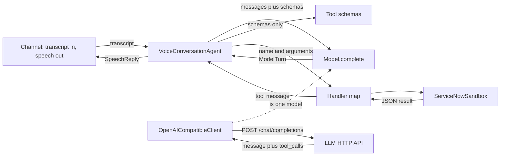

# Production shape

[README.md](README.md) describes the learning loop. This document describes the contracts between the pieces, where those contracts are too weak to run as a service, and which open-source projects fill each gap.

The loop in `agent.py` can stay. Production replaces what sits on either side of it: audio in and out, a shared session store, a model client that streams, and desk handlers that call ServiceNow for one authenticated caller.

## Who talks to whom



`ScriptedModel` implements the same `complete` method as `OpenAICompatibleClient`. The agent cannot tell them apart. That split is the one to keep: the loop depends on `ModelTurn`, and only the client depends on HTTP.

## Contracts

Each contract is what the caller of that piece is allowed to assume. The Python types below match the code as it is.

### Channel and agent

| | |
| --- | --- |
| Caller | The CLI, and later a voice pipeline |
| Callee | `VoiceConversationAgent.handle_utterance` |
| In | One utterance as a `str` |
| Out | `SpeechReply(text, tools_used, escalated)` |
| Also | Appends to `messages` and `audit`. May call handlers |

`text` has already passed through `normalize_speech`: no markdown, ticket ids respelled, empty text replaced with a repeat prompt. `escalated` is true when the `escalate` handler returns `transferred`, or when the loop hits `MAX_STEPS` (4) and speaks the transfer line.

The channel owns turn-taking. The agent owns one utterance. The agent does not know whether the text came from a keyboard or from speech-to-text.

### Agent and model

Anything with this method is a model. `OpenAICompatibleClient` and `ScriptedModel` both are. There is no base class.

```text
complete(messages: list[dict], tools: list[dict]) -> ModelTurn
```

`ModelTurn` is either spoken text, tool calls, or both:

```text
ModelTurn.content: str or None
ModelTurn.tool_calls: list[ToolCall]
ToolCall.id: str
ToolCall.name: str
ToolCall.arguments: dict
```

`messages` is the OpenAI chat list. The agent is the only writer.

| role | When it is appended | Shape |
| --- | --- | --- |
| `system` | Once, at construction | `{role, content: system_prompt}` |
| `user` | Start of every utterance, after redaction | `{role, content}` |
| `assistant` | Model returned tool calls | `{role, content, tool_calls: [{id, type: function, function: {name, arguments}}]}` |
| `tool` | After each handler returns | `{role, tool_call_id, content}` where `content` is a JSON string |
| `assistant` | Model returned speech | `{role, content}` after `normalize_speech` |

`tools` is the JSON schemas in `TOOLS`. The model sees names, descriptions, and argument schemas. It does not see the handler functions.

If the model returns tool calls, the agent runs them and calls `complete` again with the tool results appended. If it returns text, the agent stops. After 4 model calls with no text, the agent stops anyway and speaks a transfer.

### Model client and the LLM

This contract belongs to `OpenAICompatibleClient` only. `ScriptedModel` never crosses it.

| | |
| --- | --- |
| Request | `POST {base_url}/chat/completions` |
| Auth | `Authorization: Bearer {api_key}` |
| Body | `model`, `messages`, `tools`, `tool_choice: auto`, `temperature: 0.2` |
| Success | `choices[0].message`. `content` becomes `ModelTurn.content`. Each `tool_calls[].function` becomes a `ToolCall`. `arguments` is a JSON string and is parsed into a dict |
| Retry | HTTP 429, 500, 502, 503, and network errors. Three attempts, backoff 0.4s, 0.8s, 1.6s. Other HTTP statuses fail immediately |
| Timeout | 30 seconds for the whole response |

The LLM is the remote program behind that URL: OpenAI, Azure, vLLM, or Ollama. Swapping the LLM means changing `base_url` and `model`. Swapping the client means still returning a `ModelTurn`.

The client does not stream, does not pool connections, and does not attach a request id. A voice deadline has to be added here.

### Agent and tools

Tools have two faces. The schema is what the model is allowed to ask for. The handler is what the program runs.

Schema, from `TOOLS`:

```text
{type: function, function: {name, description, parameters}}
```

Handler, supplied to `VoiceConversationAgent`:

```text
name -> (**arguments) -> dict
```

`_run_tool` enforces the boundary:

| Situation | Result dict |
| --- | --- |
| `name` is not in the handler map | `{ok: false, error: unknown_tool}` |
| Arguments do not match the function signature | `{ok: false, error: bad_arguments}` |
| Handler returns | That dict, unchanged |

The result is JSON-encoded and stored as the `tool` message. The next `complete` call is how the model sees it. Any other exception leaves `handle_utterance`. Production handlers should catch their own failures and return `{ok: false, error}` so the model can recover inside the loop.

`build_agent` is the only place that binds schemas to this desk:

| Schema name | Handler | Reads or writes |
| --- | --- | --- |
| `search_knowledge` | `ServiceNowSandbox.search_knowledge(query)` | Read |
| `get_incident` | `ServiceNowSandbox.get_incident(number)` | Read |
| `create_incident` | `ServiceNowSandbox.create_incident(short_description, urgency, confirmed)` | Write |
| `escalate` | `ServiceNowSandbox.escalate(reason)` | Write, sets `escalated` when `transferred` is true |

Current result shapes:

| Tool | Success | Failure |
| --- | --- | --- |
| `search_knowledge` | `{ok: true, articles: [{id, title, steps}, ...]}` up to 3 | Still `ok: true` with `articles: []` |
| `get_incident` | `{ok: true, incident: {number, short_description, urgency, state}}` | `{ok: true, incident: null}` |
| `create_incident` | `{ok: true, incident: {...}}` | `{ok: false, error}` and, for a missing confirmation, a `hint` |
| `escalate` | `{ok: true, transferred: true, queue, reason}` | None today |

### Where these contracts are too weak

These are the same objects. The promises they make are not enough for more than one live call.

| Contract | What the code promises | What production has to add |
| --- | --- | --- |
| Channel | One string in, one `SpeechReply` out | Streaming audio, barge-in that cancels the in-flight `complete`, a wall-clock budget for the turn |
| Session | `messages` and `audit` on the agent object | A store keyed by call id, a lock, a size cap, a TTL. A second process must be able to resume the call |
| Model client | One JSON body, 30s, three retries | Streaming tokens, a short deadline, connection pooling, a fallback model, a request id on every call |
| Writes | `create_incident` trusts the `confirmed` boolean the model sends | The harness records that the caller agreed. The handler ignores the model's flag. An idempotency key so a retried yes opens one ticket |
| Reads | `get_incident` returns any id in the dict | The handler takes the authenticated caller and returns only that caller's records |
| Tool errors | `TypeError` becomes `bad_arguments`. Anything else crashes the turn | Per-tool timeout. Every desk error returns `{ok: false, error}` |
| Redaction | Three regexes on the user line, before it is stored | The same scrub on tool arguments and logs. Spoken digit sequences, not only `123-45-6789` |
| Audit | An in-memory list. `tool_call` stores raw arguments | Structured logs and traces. Secrets already removed. A retention period |

## What to adopt

Use a library at a seam. Leave `handle_utterance` as the owner of propose, act, and stop until the flow itself becomes a state machine.

LangChain's older agent executor is a second copy of the loop you already have, with the tool boundary hidden inside the framework. That is the seam voice code needs to see, because barge-in has to cancel a specific model call and a specific tool call. [LangGraph](https://github.com/langchain-ai/langgraph) is the piece of that ecosystem that adds something this loop lacks: checkpointed state and a pause for a human decision. [Pydantic AI](https://pydantic.dev/docs/ai/comparisons/vs-langchain-langgraph/) is the closer library if you want typed tools and plain Python control flow. For this desk, adopt either one only when you are ready to move the loop. Until then, keep the handlers as plain functions so an eval can call them with no framework in the way.

### By seam

| Seam | Keep | Open source to put there | Why this one |
| --- | --- | --- | --- |
| Agent loop | `handle_utterance` | Stay custom. [LangGraph](https://github.com/langchain-ai/langgraph) when confirmation, identity check, and escalation are real branches you must pause and resume. [Pydantic AI](https://github.com/pydantic/pydantic-ai) when you want typed tool arguments and usage limits without a graph | This turn is propose, tool, speak. A graph pays off when a crash must resume mid-confirmation, or when several agents hand off. [A 2026 comparison](https://lazar-milicevic.com/blog/ai-agent-stack-in-2026-langgraph-vs-custom-vs-diy) puts a short tool loop in the custom column and LangGraph in the branching column |
| Model client | `OpenAICompatibleClient` | [openai-python](https://github.com/openai/openai-python) for one provider with streaming. [LiteLLM](https://github.com/BerriAI/litellm) to route the same `complete` across OpenAI, Azure, and a self-hosted vLLM or Ollama URL, with fallbacks. [httpx](https://github.com/encode/httpx) plus [tenacity](https://github.com/jd/tenacity) if you keep your own client and add pooling | The agent should still receive a `ModelTurn`. Streaming and a deadline are the missing behavior, not a new orchestration layer |
| Session | `messages` on the object | [Valkey](https://github.com/valkey-io/valkey) or Redis for the hot transcript, a per-call lock, and a TTL. PostgreSQL for the durable audit and idempotency keys | Conversation state is the message list, not a vector database. Summarize old turns when the list hits the cap. LangGraph's `PostgresSaver` is the session store only if the loop moves to LangGraph |
| Knowledge read | `search_knowledge` word overlap | The ServiceNow knowledge API behind the same handler. [pgvector](https://github.com/pgvector/pgvector) only if you own a corpus the desk does not already search | The tool contract stays `{ok, articles}`. The retrieval engine is inside the handler |
| Voice channel | stdin and a printed line | [LiveKit Agents](https://github.com/livekit/agents) when the call is WebRTC or SIP and you want their turn detection, barge-in, and telephony. [Pipecat](https://github.com/pipecat-ai/pipecat) when you want an explicit audio pipeline and a choice of transport, including WebSocket and LiveKit | Both own streaming STT, LLM, and TTS. Your `handle_utterance` becomes the LLM step, or you move the tool loop into their session and keep the handlers. LiveKit server is Apache-2.0. Pipecat is BSD-2-Clause. A [side-by-side of the two](https://duplexcompute.com/research/pipecat-vs-livekit/) separates the media server from the agent framework |
| Speech models, self-hosted | none | [faster-whisper](https://github.com/SYSTRAN/faster-whisper) for STT. [Piper](https://github.com/OHF-Voice/piper1-gpl) or [Kokoro](https://github.com/hexgrad/kokoro) for TTS. Silero VAD, as used by those voice frameworks, for end of turn | Hosted STT and TTS are fine behind the same channel contract. These are the open-source engines when the audio cannot leave the network |
| Redaction | three regexes in `redact` | [Presidio](https://github.com/microsoft/presidio) in front of `redact`, on user text, tool arguments, and log fields | Presidio finds the entity. Your function still decides the token that replaces it, so the prompt's `[REDACTED_SSN]` contract stays |
| Traces | `audit` list | [OpenTelemetry](https://opentelemetry.io/) spans for the turn, the model call, and each tool. [Langfuse](https://github.com/langfuse/langfuse) as the trace store | One trace per call id. Span attributes are tool name and latency, not raw arguments. LangGraph and Pydantic AI can emit OpenTelemetry, so the trace contract survives a later loop change |
| Evals | `--self-check` | [pytest](https://github.com/pytest-dev/pytest) for the guards. [promptfoo](https://github.com/promptfoo/promptfoo) for a set of transcripts and the tool trace each one must produce | The eval calls `handle_utterance` or the handlers. It does not import a framework. Keep `ScriptedModel` for the guard tests, and run promptfoo against a real model on a schedule |
| Config | `os.environ` inside `live` | [pydantic-settings](https://github.com/pydantic/pydantic-settings) for base URL, model name, deadlines, and desk endpoint | Secrets stay in the environment or a Kubernetes secret. The settings object is what the client and the handlers receive |

### A stack that matches this desk

| Piece | Choice |
| --- | --- |
| Loop | `agent.py`, unchanged until a turn must pause and resume |
| Client | openai-python or LiteLLM, returning `ModelTurn`, streaming |
| Session | Valkey for the message list and lock. PostgreSQL for audit rows and idempotency keys |
| Desk | Handlers that call ServiceNow. Same result dicts as the sandbox |
| Audio | LiveKit Agents if the product is phone and WebRTC. Pipecat if the transport is already a WebSocket you control |
| Safety | Presidio, then the existing `redact` and `normalize_speech` |
| Operations | OpenTelemetry and Langfuse. pytest and promptfoo |

`ServiceNowSandbox` and `ScriptedModel` stay in the repo as the fakes those tests use.
