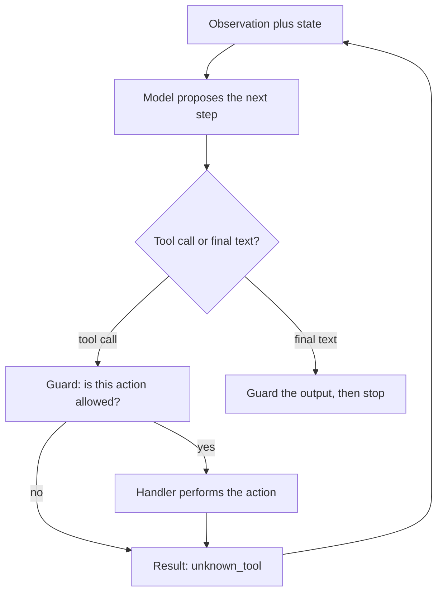
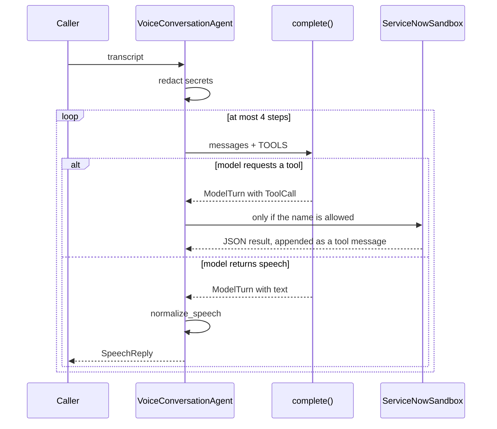
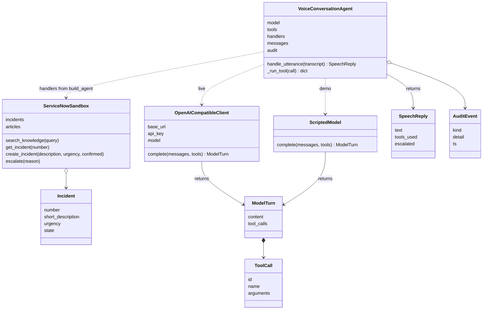

# Voice desk agent

`voice_agent.py` is a phone-style IT support agent. A caller speaks (here, types a transcript). The program sends that text to a language model. The model either asks for a tool — look up a fix, read a ticket, open a ticket, or transfer to a person — or it returns a short sentence to be spoken aloud.

The model is used as an API. This code does not train or fine-tune anything. A line-by-line trace of one live call is in [FLOW.md](FLOW.md). Production boundaries, the contracts between these pieces, and open-source replacements are in [PRODUCTION.md](PRODUCTION.md).

There are three modules:

| Module | What it owns |
| --- | --- |
| `model_client.py` | `OpenAICompatibleClient`, `ModelTurn`, `ToolCall` |
| `agent.py` | `VoiceConversationAgent`, `SpeechReply`, `AuditEvent`, `redact`, `normalize_speech` |
| `voice_agent.py` | `SYSTEM_PROMPT`, `TOOLS`, `ServiceNowSandbox`, `ScriptedModel`, the CLI |

`VoiceConversationAgent` takes the system prompt, the tool schemas, and a handler map as arguments. `build_agent` in `voice_agent.py` is the only place that connects those to this desk. A second desk can reuse `agent.py` and `model_client.py` by passing its own prompt and handlers.

`--demo` and `--self-check` use `ScriptedModel`, a fixed stand-in so the loop runs without an API key. `--live` uses `OpenAICompatibleClient`, which POSTs to `/chat/completions`. Both expose the same method, so the agent does not change.

## What any agent contains

An agent is a loop. The model proposes the next step. Your program decides whether that step is allowed, carries it out, and decides when to stop. The model does not hold the goal, the memory, or the side effects.

Keep these seven parts. The names can change. The jobs should not.

| Part | Job | In this repo |
| --- | --- | --- |
| Contract | Who the agent is, what a finished turn looks like, and what it must refuse | `SYSTEM_PROMPT` |
| Observation | The new input the agent is allowed to see this step | The caller line after `redact` |
| State | What must still be true on the next step | `messages` and `audit` |
| Actions | The only ways the agent may affect the world, each with a name, a "when to use this", and an argument schema | `TOOLS` plus the handler map |
| Loop | Propose, act, observe the result, repeat | `handle_utterance` |
| Guards | Checks that still hold when the model ignores the prompt | Redaction, the handler allow-list, `confirmed=true`, `normalize_speech`, `MAX_STEPS` |
| Stop | A final answer, a handoff, or a clear failure | Spoken `SpeechReply`, or the transfer line after 4 steps |



Three separations make the next agent easier to write:

- **The model is stateless.** It sees the messages you send and returns one turn. Memory is the message list you keep, not something inside the model.
- **The loop is generic.** `agent.py` does not know about tickets. It knows how to call `complete`, run a named handler, and stop.
- **The product is the contract and the actions.** A different agent is a different prompt, a different tool list, and different handlers. The loop stays.

Before writing a new one, answer five questions:

1. What is one observation? A chat message, a ticket event, a monitor alert.
2. What does done look like? A sentence to a person, a row written, a handoff.
3. Which actions only read, and which actions change something? Put the change behind a check in code, not only in the prompt.
4. What is still true if the model asks for the wrong tool or never stops? Allow-list, argument check, step cap.
5. What do you record so a bad turn can be explained later? An audit of proposals and results, with secrets already removed.

## One caller turn



`handle_utterance` is the whole product path:

1. `redact` strips SSN, card, and password text. The model never sees the original secret. A redaction is written to `audit`.
2. The cleaned line is appended as a `user` message. The first message in the list is always the system prompt.
3. The agent calls `model.complete(messages, TOOLS)`.
4. If the reply contains tool calls, `_run_tool` runs the matching handler and appends the JSON result. For this desk those handlers are methods on `ServiceNowSandbox`. Then the loop calls the model again so it can speak from that result.
5. If the reply is plain text, `normalize_speech` strips markdown and respells ticket ids (`INC0010002` becomes `I N C, 0 0 1, 0 0 0, 2`) so text-to-speech can read them. That string is the caller's reply.
6. After 4 model calls with no spoken reply, the agent stops and says it will transfer the caller. A model that only emits tool calls cannot spin.

The prompt tells the model to wait for a "yes" before opening a ticket. `create_incident` also refuses `confirmed=false`, so a skipped confirmation does not write a ticket. Unknown tool names return `unknown_tool` and are not dispatched.

## Class diagram

`OpenAICompatibleClient` and `ScriptedModel` are not subclasses of anything. Either one can be passed in as `model`. The dashed arrows are that plug-in. The solid arrows are objects the agent holds or returns.



| Type | Role |
| --- | --- |
| `VoiceConversationAgent` | Conversation state, the tool loop, and the audit log |
| `OpenAICompatibleClient` | HTTP call to an OpenAI-compatible server (OpenAI, Azure, vLLM, Ollama) |
| `ScriptedModel` | Offline stand-in with the same `complete` method |
| `ServiceNowSandbox` | In-memory tickets and knowledge articles. A real desk would call the ServiceNow Table API from these four methods |
| `Incident` | One ticket |
| `ModelTurn` | One model response: spoken text, tool calls, or both |
| `ToolCall` | One requested function name plus arguments |
| `SpeechReply` | What the caller hears, which tools ran, and whether the call was handed off |
| `AuditEvent` | Redaction, model request, tool call, tool result, or final speech. Secrets are not stored |

`redact` and `normalize_speech` are functions, not classes. They sit on the edges of `handle_utterance`: secrets are removed on the way in, and the spoken form is enforced on the way out.

## Where to read

Read in this order.

| File | What it is |
| --- | --- |
| `voice_agent.py` — `SYSTEM_PROMPT`, `TOOLS` | The only instructions the model sees |
| `model_client.py` — `ToolCall`, `ModelTurn`, `OpenAICompatibleClient` | The HTTP client and the records it returns |
| `agent.py` — `redact`, `normalize_speech`, `SpeechReply`, `AuditEvent` | Input guard, output guard, and the records the loop returns |
| `voice_agent.py` — `ServiceNowSandbox` | The four tools and the confirmation check |
| `voice_agent.py` — `ScriptedModel` | Offline backend with the same `complete` method |
| `agent.py` — `VoiceConversationAgent.handle_utterance` | The loop in the sequence diagram |
| `voice_agent.py` — `build_agent` | Wires the prompt, schemas, and desk methods into the loop |

## Run

```bash
python3 voice_agent.py --demo           # two-turn VPN call, no API key
python3 voice_agent.py --self-check     # redaction, confirmation, unknown tool, step cap
python3 voice_agent.py --show-contract  # print the prompt and tool schemas
OPENAI_API_KEY=... python3 voice_agent.py --live
python3 voice_agent.py --live --verbose  # full JSON sent, received, and tool results
python3 voice_agent.py --demo --audit    # in-memory audit list after each line
```

A self-hosted model uses the same client:

```bash
OPENAI_BASE_URL=http://localhost:11434/v1 OPENAI_API_KEY=ollama \
  OPENAI_MODEL=llama3.1 python3 voice_agent.py --live
```
