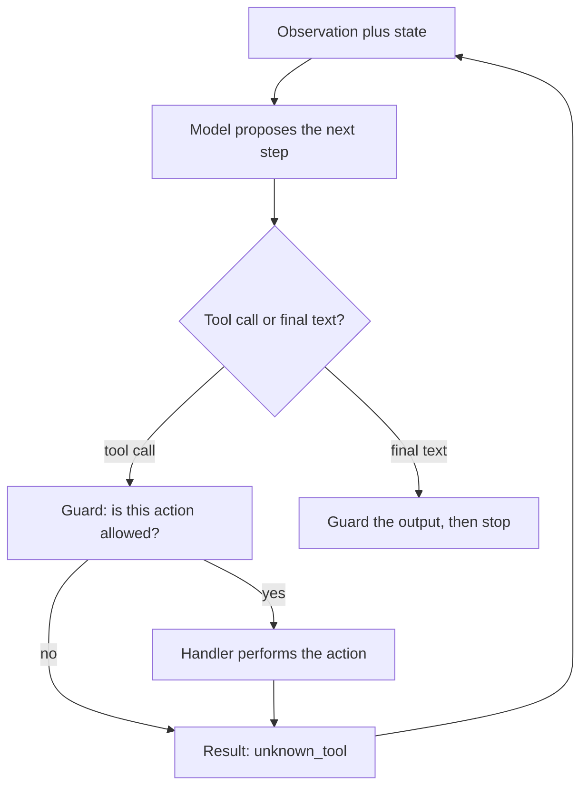
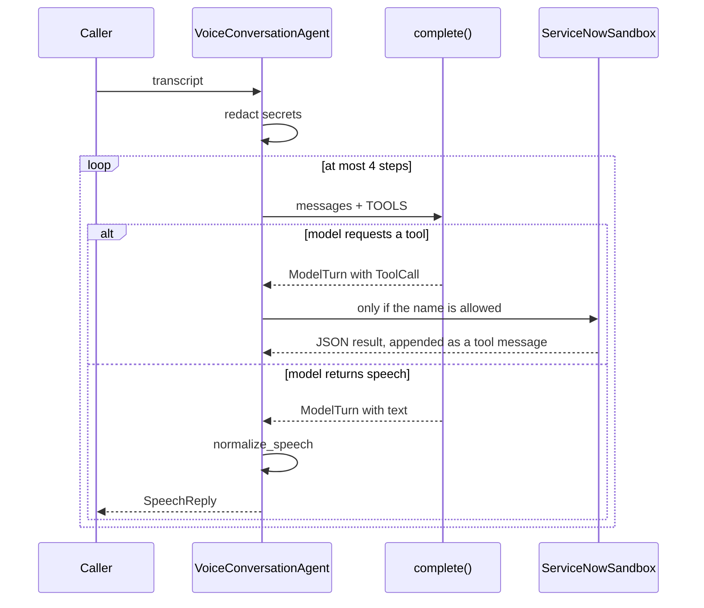

# Voice desk agent

The same IT desk is built three times. Two of them use the standard library. The third draws the single-agent loop as a LangGraph.

| Folder | What it is |
| --- | --- |
| [single_agent/](single_agent/) | One model, one prompt, four tools. Read this first. |
| [multi_agent/](multi_agent/) | A router and three specialists do the same call. |
| [single_agent_langgraph/](single_agent_langgraph/) | The single-agent loop as graph nodes. Needs the virtualenv in [requirements.txt](requirements.txt). |
| [local_llm/](local_llm/) | Ollama and Open WebUI on a Kind cluster, installed with Helm. |
| [chatgpt_live/](chatgpt_live/) | A GPT-Live (`gpt-live-1`) session. The spoken path, and which library owns each step, is in [chatgpt_live/README.md](chatgpt_live/README.md). |

`single_agent/voice_agent.py` is a phone-style IT support agent. A caller speaks (here, types a transcript). The program sends that text to a language model. The model either asks for a tool — look up a fix, read a ticket, open a ticket, or transfer to a person — or it returns a short sentence to be spoken aloud.

The model is used as an API. This code does not train or fine-tune anything. A line-by-line trace of one live call is in [FLOW.md](FLOW.md). How to write the system prompt is in [PROMPT.md](PROMPT.md). Production boundaries are in [PRODUCTION.md](PRODUCTION.md). The fleet shape for a million turns a minute, and which open-source project sits at each layer, is in [SCALE.md](SCALE.md). Whether LangChain or LangGraph would make the multi-agent version shorter is answered in [multi_agent/README.md](multi_agent/README.md). The runnable graph is in [single_agent_langgraph/README.md](single_agent_langgraph/README.md). Other multi-agent shapes, where call state is stored, and short LangChain and LangGraph sketches are in [PATTERNS.md](PATTERNS.md).

The single agent has three modules:

| Module | What it owns |
| --- | --- |
| `single_agent/model_client.py` | `OpenAICompatibleClient`, `ModelTurn`, `ToolCall` |
| `single_agent/agent.py` | `VoiceConversationAgent`, `SpeechReply`, `AuditEvent`, `redact`, `normalize_speech` |
| `single_agent/voice_agent.py` | `SYSTEM_PROMPT`, `TOOLS`, `ServiceNowSandbox`, `ScriptedModel`, the CLI |

`VoiceConversationAgent` takes the system prompt, the tool schemas, and a handler map as arguments. `build_agent` in `single_agent/voice_agent.py` is the only place that connects those to this desk. A second desk can reuse `agent.py` and `model_client.py` by passing its own prompt and handlers. The multi-agent folder does that: same client, same sandbox, different prompts and smaller tool lists.

`--demo` and `--self-check` use `ScriptedModel`, a fixed stand-in so the loop runs without an API key. `--live` uses `OpenAICompatibleClient`, which POSTs to `/chat/completions`. Both expose the same method, so the agent does not change.

## What any agent contains

An agent is a loop. The model proposes the next step. Your program decides whether that step is allowed, carries it out, and decides when to stop. The model does not hold the goal, the memory, or the side effects.

Keep these seven parts. The names can change. The jobs should not.

| Part | Job | In this repo |
| --- | --- | --- |
| Contract | Who the agent is, what a finished turn looks like, and what it must refuse | `SYSTEM_PROMPT` |
| Observation | The new input the agent is allowed to see this step | The caller line after `redact` |
| State | What must still be true on the next step | `messages` and `audit` |
| Actions | The only ways the agent may affect the world, each with a name, a "when to use this", and an argument schema | `TOOLS` plus the handler map |
| Loop | Propose, act, observe the result, repeat | `handle_utterance` |
| Guards | Checks that still hold when the model ignores the prompt | Redaction, the handler allow-list, `confirmed=true`, `normalize_speech`, `MAX_STEPS` |
| Stop | A final answer, a handoff, or a clear failure | Spoken `SpeechReply`, or the transfer line after 4 steps |



Three separations make the next agent easier to write:

- **The model is stateless.** It sees the messages you send and returns one turn. Memory is the message list you keep, not something inside the model.
- **The loop is generic.** `single_agent/agent.py` does not know about tickets. It knows how to call `complete`, run a named handler, and stop.
- **The product is the contract and the actions.** A different agent is a different prompt, a different tool list, and different handlers. The loop stays.

Before writing a new one, answer five questions:

1. What is one observation? A chat message, a ticket event, a monitor alert.
2. What does done look like? A sentence to a person, a row written, a handoff.
3. Which actions only read, and which actions change something? Put the change behind a check in code, not only in the prompt.
4. What is still true if the model asks for the wrong tool or never stops? Allow-list, argument check, step cap.
5. What do you record so a bad turn can be explained later? An audit of proposals and results, with secrets already removed.

## One caller turn



`handle_utterance` is the whole product path:

1. `redact` strips SSN, card, and password text. The model never sees the original secret. A redaction is written to `audit`.
2. The cleaned line is appended as a `user` message. The first message in the list is always the system prompt.
3. The agent calls `model.complete(messages, TOOLS)`.
4. If the reply contains tool calls, `_run_tool` runs the matching handler and appends the JSON result. For this desk those handlers are methods on `ServiceNowSandbox`. Then the loop calls the model again so it can speak from that result.
5. If the reply is plain text, `normalize_speech` strips markdown and respells ticket ids (`INC0010002` becomes `I N C, 0 0 1, 0 0 0, 2`) so text-to-speech can read them. That string is the caller's reply.
6. After 4 model calls with no spoken reply, the agent stops and says it will transfer the caller. A model that only emits tool calls cannot spin.

The prompt tells the model to wait for a "yes" before opening a ticket. `create_incident` also refuses `confirmed=false`, so a skipped confirmation does not write a ticket. Unknown tool names return `unknown_tool` and are not dispatched.

## Class diagram

`OpenAICompatibleClient` and `ScriptedModel` are not subclasses of anything. Either one can be passed in as `model`. The dashed arrows are that plug-in. The solid arrows are objects the agent holds or returns.


| Type | Role |
| --- | --- |
| `VoiceConversationAgent` | Conversation state, the tool loop, and the audit log |
| `OpenAICompatibleClient` | HTTP call to an OpenAI-compatible server (OpenAI, Azure, vLLM, Ollama) |
| `ScriptedModel` | Offline stand-in with the same `complete` method |
| `ServiceNowSandbox` | In-memory tickets and knowledge articles. A real desk would call the ServiceNow Table API from these four methods |
| `Incident` | One ticket |
| `ModelTurn` | One model response: spoken text, tool calls, or both |
| `ToolCall` | One requested function name plus arguments |
| `SpeechReply` | What the caller hears, which tools ran, and whether the call was handed off |
| `AuditEvent` | Redaction, model request, tool call, tool result, or final speech. Secrets are not stored |

`redact` and `normalize_speech` are functions, not classes. They sit on the edges of `handle_utterance`: secrets are removed on the way in, and the spoken form is enforced on the way out.

## Where to read

Read in this order.

| File | What it is |
| --- | --- |
| `single_agent/voice_agent.py` — `SYSTEM_PROMPT`, `TOOLS` | The only instructions the model sees. The section order is in [PROMPT.md](PROMPT.md) |
| `single_agent/model_client.py` — `ToolCall`, `ModelTurn`, `OpenAICompatibleClient` | The HTTP client and the records it returns |
| `single_agent/agent.py` — `redact`, `normalize_speech`, `SpeechReply`, `AuditEvent` | Input guard, output guard, and the records the loop returns |
| `single_agent/voice_agent.py` — `ServiceNowSandbox` | The four tools and the confirmation check |
| `single_agent/voice_agent.py` — `ScriptedModel` | Offline backend with the same `complete` method |
| `single_agent/agent.py` — `VoiceConversationAgent.handle_utterance` | The loop in the sequence diagram |
| `single_agent/voice_agent.py` — `build_agent` | Wires the prompt, schemas, and desk methods into the loop |
| [multi_agent/README.md](multi_agent/README.md) | The same call split into a router, specialists, and a voice agent |
| [single_agent_langgraph/CONCEPTS.md](single_agent_langgraph/CONCEPTS.md) | What a LangGraph node, edge, and checkpoint are |
| [single_agent_langgraph/README.md](single_agent_langgraph/README.md) | That single-agent loop as LangGraph nodes |
| [single_agent_langgraph/FLOW.md](single_agent_langgraph/FLOW.md) | How that graph is built, then one caller line through the nodes |
| [chatgpt_live/README.md](chatgpt_live/README.md) | A GPT-Live call: microphone, socket, speakers, and the delegation handoff |
| [SCALE.md](SCALE.md) | Cells, GPU math, and the open-source piece at each layer for a million turns a minute |

## Run

```bash
python3 single_agent/voice_agent.py --demo           # two-turn VPN call, no API key
python3 single_agent/voice_agent.py --self-check     # redaction, confirmation, unknown tool, step cap
python3 single_agent/voice_agent.py --show-contract  # print the prompt and tool schemas
python3 multi_agent/run.py --demo                    # same call, routed across agents
python3 multi_agent/run.py --self-check              # speech matches the single agent
OPENAI_API_KEY=... python3 single_agent/voice_agent.py --live
python3 single_agent/voice_agent.py --live --verbose  # full JSON sent, received, and tool results
python3 single_agent/voice_agent.py --demo --audit    # in-memory audit list after each line
```

The LangGraph desk uses the virtualenv. Python 3.12 is in `.python-version`.

```bash
uv venv --python 3.12 .venv
uv pip install -r requirements.txt
.venv/bin/python single_agent_langgraph/run.py --demo
.venv/bin/python single_agent_langgraph/run.py --self-check
```

A self-hosted model uses the same client. [local_llm/](local_llm/) runs that server on a Kind cluster and opens Open WebUI at http://localhost:8080. The model it pulls is `llama3.2:3b`.

```bash
OPENAI_BASE_URL=http://localhost:11434/v1 OPENAI_API_KEY=ollama \
  OPENAI_MODEL=llama3.2:3b python3 single_agent/voice_agent.py --live
```

GPT-Live is a separate session, documented in [chatgpt_live/README.md](chatgpt_live/README.md). The scripted trace needs no key. `--live` uses the virtualenv.

```bash
python3 chatgpt_live/run.py --self-check
OPENAI_API_KEY=... .venv/bin/python chatgpt_live/run.py --live
```
