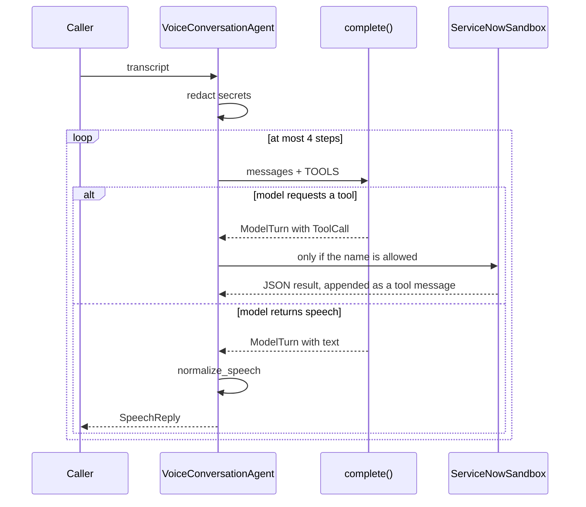
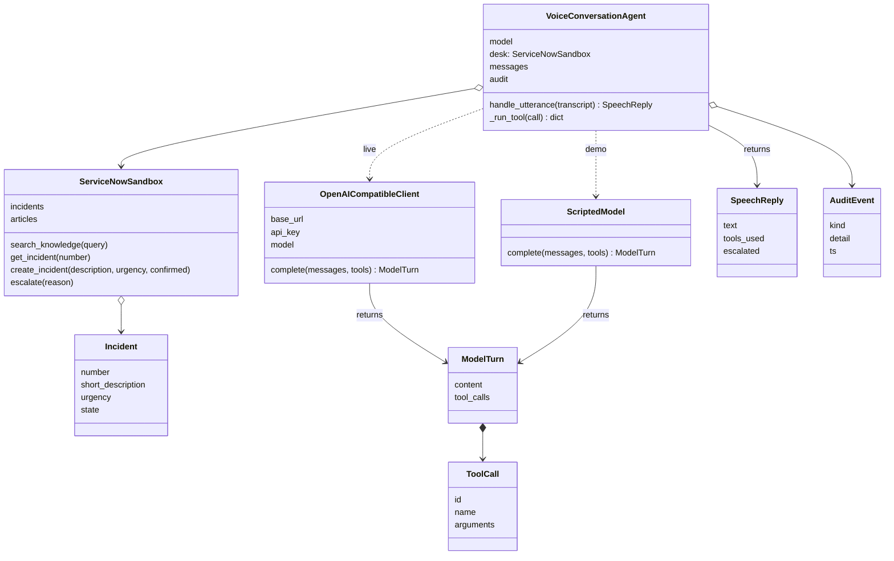

# Voice desk agent

`voice_agent.py` is a phone-style IT support agent. A caller speaks (here, types a transcript). The program sends that text to a language model. The model either asks for a tool — look up a fix, read a ticket, open a ticket, or transfer to a person — or it returns a short sentence to be spoken aloud.

The model is used as an API. This code does not train or fine-tune anything.

There are three pieces:

1. **The contract** the model is given: a system prompt plus four tool schemas (`SYSTEM_PROMPT`, `TOOLS`).
2. **The agent** (`VoiceConversationAgent`) which owns the conversation and decides when a turn is finished.
3. **Two things the agent calls**: a model (`complete`) and a ticket desk (`ServiceNowSandbox`).

`--demo` and `--self-check` use `ScriptedModel`, a fixed stand-in so the loop runs without an API key. `--live` uses `OpenAICompatibleClient`, which POSTs to `/chat/completions`. Both expose the same method, so the agent does not change.

## One caller turn



`handle_utterance` is the whole product path:

1. `redact` strips SSN, card, and password text. The model never sees the original secret. A redaction is written to `audit`.
2. The cleaned line is appended as a `user` message. The first message in the list is always the system prompt.
3. The agent calls `model.complete(messages, TOOLS)`.
4. If the reply contains tool calls, `_run_tool` runs the matching method on `ServiceNowSandbox` and appends the JSON result. Then the loop calls the model again so it can speak from that result.
5. If the reply is plain text, `normalize_speech` strips markdown and respells ticket ids (`INC0010002` becomes `I N C, 0 0 1, 0 0 0, 2`) so text-to-speech can read them. That string is the caller's reply.
6. After 4 model calls with no spoken reply, the agent stops and says it will transfer the caller. A model that only emits tool calls cannot spin.

The prompt tells the model to wait for a "yes" before opening a ticket. `create_incident` also refuses `confirmed=false`, so a skipped confirmation does not write a ticket. Unknown tool names return `unknown_tool` and are not dispatched.

## Class diagram

`OpenAICompatibleClient` and `ScriptedModel` are not subclasses of anything. Either one can be passed in as `model`. The dashed arrows are that plug-in. The solid arrows are objects the agent holds or returns.



| Type | Role |
| --- | --- |
| `VoiceConversationAgent` | Conversation state, the tool loop, and the audit log |
| `OpenAICompatibleClient` | HTTP call to an OpenAI-compatible server (OpenAI, Azure, vLLM, Ollama) |
| `ScriptedModel` | Offline stand-in with the same `complete` method |
| `ServiceNowSandbox` | In-memory tickets and knowledge articles. A real desk would call the ServiceNow Table API from these four methods |
| `Incident` | One ticket |
| `ModelTurn` | One model response: spoken text, tool calls, or both |
| `ToolCall` | One requested function name plus arguments |
| `SpeechReply` | What the caller hears, which tools ran, and whether the call was handed off |
| `AuditEvent` | Redaction, model request, tool call, tool result, or final speech. Secrets are not stored |

`redact` and `normalize_speech` are functions, not classes. They sit on the edges of `handle_utterance`: secrets are removed on the way in, and the spoken form is enforced on the way out.

## Where to read the file

Read in this order. Each block is one idea.

| Lines | What it is |
| --- | --- |
| `SYSTEM_PROMPT`, `TOOLS` | The only instructions the model sees |
| `ToolCall`, `ModelTurn`, `SpeechReply`, `AuditEvent` | The small records passed between pieces |
| `redact`, `normalize_speech` | Input and output guards |
| `ServiceNowSandbox` | The four tools and the confirmation check |
| `OpenAICompatibleClient`, `ScriptedModel` | The two model backends |
| `VoiceConversationAgent.handle_utterance` | The loop in the sequence diagram |

## Run

```bash
python3 voice_agent.py --demo           # two-turn VPN call, no API key
python3 voice_agent.py --self-check     # redaction, confirmation, unknown tool, step cap
python3 voice_agent.py --show-contract  # print the prompt and tool schemas
OPENAI_API_KEY=... python3 voice_agent.py --live
```

A self-hosted model uses the same client:

```bash
OPENAI_BASE_URL=http://localhost:11434/v1 OPENAI_API_KEY=ollama \
  OPENAI_MODEL=llama3.1 python3 voice_agent.py --live
```
