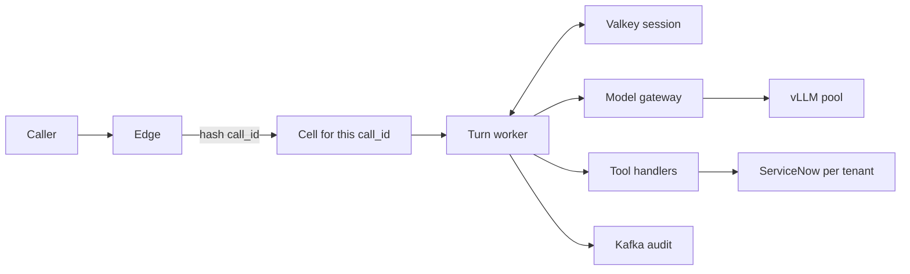

# Scaling to a million turns a minute

[PRODUCTION.md](PRODUCTION.md) is one live call: the contracts, and the open-source project at each seam. This note is the fleet around those contracts. The loop in `handle_utterance` and `DeskSession.handle_utterance` stays. What changes is everything that must be true when a second process, a second region, and a scarce GPU pool are in the path.

The pattern has a name you can say in an interview: **stateless turn workers, session state outside the process, traffic split into cells, models tiered so most turns never touch a large GPU.**

## What the number means

"Millions of conversations per minute" is three different systems depending on the noun.

| Phrase | This note uses | Per second |
| --- | --- | --- |
| 1 million **turns** per minute | The design target. One caller line in, one `SpeechReply` out | 16,667 turns/s |
| 5 million turns per minute | The same pattern, more cells and more GPUs | 83,333 turns/s |
| 1 million **new conversations** per minute | A conversation is about 6 turns, so this is 6 million turns per minute | 100,000 turns/s |

A turn is one utterance through the agent. A conversation is the session: several turns, one `call_id`, one transcript. The code you have processes turns. The store holds conversations. GPUs are sized from turns, because each turn spends model calls.

Voice and text use the same turn worker. Voice adds a media server, a speech-to-text pool, and a text-to-speech pool, and it has a harder latency budget. Those are separate GPU pools from the desk model.

## The picture

Any worker in the cell can run the next line of a call. The worker loads the transcript, runs the loop you already have, writes the transcript back, and emits audit events. It does not remember the caller after the request ends.

## What stays

These are the parts worth keeping when the process count goes from one to hundreds.

| Piece | Why it still holds |
| --- | --- |
| One utterance in, one `SpeechReply` out | The channel owns turn-taking. The worker owns one turn |
| The model is stateless | Memory is the message list you send. A GPU pod can serve any call |
| Schemas vs handlers | The model sees names. The worker runs an allow-listed function |
| `confirmed` comes from the harness | A retried "yes" is a write, so the flag still cannot be the model's boolean |
| `redact` before anything is stored | The session store and the bus see the scrubbed line |
| `MAX_STEPS` | A turn that only emits tool calls still ends |
| Specialist isolation | A specialist still starts from a handoff, not from the whole transcript. `CallFacts` is what crosses the turn |
| `RuleRouter` | The four route words are a closed set. Code that returns one word spends zero GPU |

Single-agent and multi-agent are the same fleet. A multi-agent turn spends more model calls when the router and the voice step are also models. It does not need its own cluster, its own session key, or its own cell scheme. The session record grows by a few fields: last route, symptom, agreement, ticket number.

## Planning model

These constants are for capacity planning. They are not a benchmark. Replace the GPU constant with a load test of your prompt, your model, and your output length before you buy hardware. The 150 requests/s figure already assumes an 8B model, short answers (on the order of 80 tokens), and [automatic prefix caching](https://docs.vllm.ai/en/latest/features/automatic_prefix_caching/) so the shared system prompt is not prefilled from scratch on every call.

| Constant | Value | Role |
| --- | --- | --- |
| Model calls, single agent | 1.6 per turn | A mix of speak-only lines (1 call) and tool-then-speak lines (2) |
| Model calls, multi-agent, rule router, model voice | 2.4 per turn | `RuleRouter` is free. The specialist loops. `ModelVoice` speaks |
| Model calls, multi-agent, model router and model voice | 3.4 per turn | One extra completion for the route word |
| Cache hit | 30% | Exact repeat of a normalized line. Those turns skip the GPU |
| Short requests per H100 | 150/s | Planning stand-in for one 8B replica with prefix cache |
| In-flight time | 1.2 s | Wall clock a turn holds a worker, mostly waiting on the network |
| Turns per conversation | 6 | Used only to size the session store |
| Handle time | 4 min | How long a conversation stays hot |
| Session size | 20 KB | Summarized transcript plus `CallFacts` |
| Turns per cell | 800/s | Failure domain. One cell is a few percent of the target |
| In-flight turns per worker pod | 1,500 | Async Python, waiting on HTTP. A starting point, then measure CPU |

Little's law sizes the workers: concurrent turns = turns/s × seconds in flight. At the design target that is 16,667 × 1.2 ≈ 20,000 in-flight turns. At 1,500 per pod that is 14 pods of agent code. The GPU count is an order of magnitude more interesting.

GPU count = (turns/s) × (model calls per turn) × 0.70 / 150.

| Offered load | Single agent | Multi, rules + model voice | Multi, model router + model voice |
| --- | ---: | ---: | ---: |
| 1M turns/min | 124 H100 | 187 H100 | 264 H100 |
| 5M turns/min | 622 H100 | 933 H100 | 1,322 H100 |
| 1M new conversations/min | 747 H100 | 1,120 H100 | 1,587 H100 |

Read the first row as the design target. The agent pods for that row are about 14 before spare capacity. Add spare for deploys and for a cell losing a pod: a few dozen pods, not hundreds. Session RAM for that row is about 13 GB (roughly 667,000 live conversations × 20 KB). A regional Valkey cluster holds that easily. The bill and the power draw sit on the GPU column.

Two levers move that column more than any rewrite of `agent.py`:

1. How many model calls one turn spends. `RuleRouter` and `ScriptedVoice` are the cheap end. A model router plus a model voice is the expensive end, for the same spoken answer.
2. How often a repeated IT line is answered from cache. VPN, password reset, and email-on-phone are the same sentence all day.

A 70B model does not belong on this table. It would divide the requests-per-GPU constant by a large factor and blow the voice latency budget. Use it, if at all, for a tiny fraction of turns a small model refuses.

## Why the Python loop is the easy part

`OpenAICompatibleClient` blocks a thread for the whole HTTP response, with a 30 s timeout and three retries. That client is correct for one developer at a keyboard. It is the wrong shape at 20,000 in-flight turns:

| Today | At the target |
| --- | --- |
| One thread waits on one completion | `asyncio` plus [httpx](https://github.com/encode/httpx). The pod's threads stay free while the GPU works |
| `messages` live on the agent object | Load and store them under `call:{id}` for the length of the request |
| Three retries on 429 and 5xx | Retry only when the gateway never accepted the request. A retry of an accepted generation is a second GPU job |
| 30 s timeout | A deadline inside the voice budget, and a cancel that reaches vLLM so the batch slot is released |
| In-memory `audit` | Append to a log stream. The turn does not wait for the analytics database |

A worker pod is stateless. Kubernetes schedules more of them. [KEDA](https://github.com/kedacore/keda) scales them from in-flight turns or queue depth. GPU replicas stay warm: loading an 8B model is minutes, so that pool has a floor and does not scale to zero between calls.

## Cells

A cell is a failure domain that owns a slice of `call_id`.

Hash the call id and send the turn to the cell for that hash. Every worker in the cell can serve it. The cell's Valkey holds the hot sessions for that slice. A different cell does not have the transcript, and the hot path does not call across cells to get it.

At 800 turns/s per cell, the 1M-turns/min target is about 21 cells. Lose one cell and you lose about 5% of live calls, which the edge turns into a spoken transfer. The other cells keep their own sessions and their own latency. That is the property you are buying: a bad deploy, a bad Valkey primary, or a hot key stays inside one slice.

Size a cell so that all three of these fit:

| Fit inside one cell | Starting point at 800 turns/s |
| --- | --- |
| Turn workers | 2 pods serving, 1 spare |
| Valkey | One primary and one replica. About 1 GB of sessions |
| Blast radius | About 5% of the 1M-turns/min target |

The GPU pool is regional, shared by the cells, behind the model gateway. Putting a private GPU fleet in every cell strands capacity on the quiet slices and starves the busy ones. Prefix-aware routing, below, is how the shared pool still hits a warm cache.

Roll a change to one cell, watch its p99 and its duplicate-ticket rate, then continue. [Argo Rollouts](https://github.com/argoproj/argo-rollouts) or a Helm wave per cell is enough. [Argo CD](https://github.com/argoproj/argo-cd) or [Flux](https://github.com/fluxcd/flux2) is how the cell manifests stay applied.

Regions are the larger failure domain. A voice turn cannot usefully finish in a different region from the one that holds its media and its session: the extra round trip spends the latency budget. Run the whole hot path in-region. DNS fails new calls to another region. Live calls in the failed region drop and can redial. The idempotency key for a ticket is global, so the redial does not open a second ticket.

## One turn

1. The edge authenticates the caller and hashes `call_id` to a cell.
2. A worker in that cell loads `call:{id}` from Valkey and takes the per-call lock, on the same hash slot as the record.
3. `redact` runs. The scrubbed line is the only line that enters the transcript.
4. The route is either `RuleRouter` or, when the rules are unsure, a small classifier. A "yes" during an incident confirmation stays on the incident path because `CallFacts` says so. The latest sentence is not reclassified from scratch.
5. Cache lookup on the normalized line plus the route. A hit returns the spoken answer and skips the GPU.
6. A miss calls the model gateway. The gateway enforces the tenant's token budget, the deadline, and fair queueing, then picks a vLLM replica that already holds this system prompt's prefix.
7. Tool calls hit the handler map. Reads coalesce (below). Writes carry an idempotency key.
8. The worker appends the turn, refreshes the TTL, releases the lock, and returns `SpeechReply`.
9. Audit events go to the log stream after the caller has an answer. A failed audit publish does not fail the turn. A failed ticket write does.

`MAX_STEPS` still caps the loop. Barge-in aborts step 6 and step 7. The abort has to cross the gateway into vLLM. A cancelled HTTP client that leaves the generation running still occupies a GPU.

## Model tiers

Spend GPU in this order. Stop at the first tier that can finish the turn.

| Tier | Who | GPU |
| --- | --- | --- |
| 0 | `RuleRouter`, `ScriptedVoice`, the confirmation phrases already in the harness | None |
| 1 | Exact cache of a normalized utterance for a route | None |
| 2 | A small model for the route word and for ordinary speech | A cheap pool, 1B–8B |
| 3 | The desk model that may call tools | The main 8B pool in the table above |
| 4 | A larger model for turns the desk model cannot finish inside `MAX_STEPS` | A few replicas, strict quota |

The single-agent loop already is tier 3: one prompt, tools, speak. The multi-agent split maps onto the tiers directly.

| Multi-agent piece | Tier at this rate |
| --- | --- |
| `RuleRouter` | Tier 0. Keep it as the default. `ModelRouter` is tier 2, and only when the rules return low confidence |
| Knowledge specialist | Tier 3, then tier 1 on the way out: cache the article speech for that normalized symptom |
| Incident specialist | Tier 3. The write stays on this one path so two branches cannot both open a ticket |
| Escalation specialist | Often tier 0. The harness already knows the caller asked for a person |
| `ScriptedVoice` | Tier 0 when the result dict has a known shape: article steps, a ticket number, a transfer |
| `ModelVoice` | Tier 2 for the residual, where a template would sound wrong |

Fan-out is a multiplier. Two specialists on the same line spend two model budgets. Do it only when the reads are independent, and give the pair one deadline. The voice path does not wait for a slow second read past that deadline.

Prefix caching is why the system prompt can stay long. Every replica should see the same prompt bytes for a given role, and the gateway should prefer the replica that already cached them. [Gateway API Inference Extension](https://github.com/kubernetes-sigs/gateway-api-inference-extension) does that kind of endpoint picking. A consistent hash on a prompt-prefix id inside the gateway is the same idea. [LMCache](https://github.com/LMCache/LMCache) is the next step when the KV cache itself has to be shared across replicas rather than rebuilt on each one.

Disaggregated prefill and decode (SGLang or vLLM split, [Mooncake](https://github.com/kvcache-ai/Mooncake)) matters when the prompt is long and the answer is long. This desk's answers are short. Prefix caching and a small model for the route word move the number more. Measure prefill time versus decode time on a real turn before you split the GPUs.

## Session, lock, idempotency

Three stores, three jobs. Mixing them is how a fleet loses tickets or leaks secrets.

| Store | Holds | Lifetime | Open source |
| --- | --- | --- | --- |
| Hot session | Transcript, `CallFacts`, last route, lock | The call, plus a TTL | [Valkey](https://github.com/valkey-io/valkey) cluster |
| Idempotency and the agreement | "Caller agreed", external id, ticket number | Until the ticket exists in ServiceNow, and then for the dedupe window | PostgreSQL |
| Audit | Redaction, route, tool name, latency, scrubbed arguments | The retention period | Kafka or Redpanda, then ClickHouse |

The hot key is `call:{id}`. The lock key is hashed to the same slot, so the lock and the record move together. A second worker that arrives for the same call waits or rejects. Two workers must not append the same line.

When the transcript hits a token cap, summarize the older turns and keep the recent ones plus `CallFacts`. Summarize asynchronously. The next turn reads the summary you already stored, not a summary you compute on the critical path.

`create_incident` uses an idempotency key of tenant, caller, call id, and a hash of the confirmed symptom. The unique row is inserted before the handler calls ServiceNow. A retry, a second pod, or a redial in another region finds the row and returns the same ticket number. The in-memory counter in `ServiceNowSandbox` cannot do this. ServiceNow's correlation id is the external copy of the same key.

If the loop later moves to LangGraph, the checkpointer is the hot session, not the audit log and not the idempotency table. [PostgresSaver](https://github.com/langchain-ai/langgraph) on every super-step at 16,667 turns/s will pin the database. Keep a Valkey or Redis checkpointer for ordinary turns. Use a durable checkpoint for the confirmation `interrupt`, which is rare and must survive a crash. A node that writes still uses the idempotency key, because a resume runs the node from the start of its function.

[Temporal](https://github.com/temporalio/temporal) is for work that outlives the call: open the ticket, wait for a person, notify the caller later. The workflow id is the idempotency key. The turn worker starts the workflow and speaks. It does not block until a human closes the incident.

## Hot keys

A VPN outage is one sentence from tens of thousands of callers. That is one knowledge query, not tens of thousands of ServiceNow reads.

Singleflight: the first request for a normalized query in a region performs the read. The others wait for that result and then share it. Cache the article speech for a short TTL (start at 30–60 s) so the herd after the first fill is a Valkey get. Do this in the tool handler, region-wide. An in-process lock only coalesces one pod.

The same stampede hits the cache key itself. A single Valkey key that every worker gets is fine at this rate; Valkey handles that read. The failure mode is a missing key, when every worker decides it is the one to refill. A short lock around the fill is the fix. [groupcache](https://github.com/golang/groupcache) is the classic writeup of singleflight. The desk can implement the same two-step in the handler: Valkey cache, then a Valkey lock for the fill.

Writes do not coalesce. Two callers who both say yes get two idempotency keys and two tickets. They share a cached article. They do not share an incident.

## Admission, fairness, cancel

The gateway's job is to keep the GPU pool inside the latency budget when the math is wrong.

| Signal | Response |
| --- | --- |
| Queue time would miss the voice budget | Shed. Play the transfer line from a template. Do not enqueue |
| One tenant's arrival rate jumps | That tenant's token bucket empties. Other tenants keep their share |
| vLLM returns 429 or is saturated | Count it as load. Shed. A retry multiplies a brownout |
| Connection died before the gateway accepted the request | One retry is safe. The GPU never started |
| Caller barges in | Cancel the stream. vLLM aborts the generation |

Fairness is weighted fair queueing at the gateway, with a per-tenant bucket in Valkey. A global FIFO gives the noisiest tenant the whole pool. [Envoy](https://github.com/envoyproxy/envoy) rate-limit service and [LiteLLM proxy](https://github.com/BerriAI/litellm) both implement tenant limits. Pick one place to enforce them so two layers do not disagree.

Hedge requests (send the same completion to two replicas, keep the faster) double the GPU bill. This desk does not hedge.

The per-tenant write budget is separate. A fleet rate of hundreds of incident creates per second is plausible only as a sum across many ServiceNow instances. Each tenant's Table API has its own limit. Queue writes per tenant, and let the handler return `{ok: false, error}` when that tenant's budget is spent, so the model can speak a retry instead of timing out the turn.

## Voice budget

A text turn can spend a couple of seconds. A voice turn needs first audio inside about 1.5 s, or the caller talks over you.

These are composed budgets for planning, in milliseconds to first audio, not measured traces.

| Path | First audio | How it gets there |
| --- | ---: | --- |
| Exact cache hit | 180 | Session load, cache, TTS first chunk, network |
| Single agent, tokens streamed into TTS | 780 | Two short generations. TTS starts on the first phrase of the spoken turn |
| Multi-agent, rule router, streamed | 980 | Specialist, then voice, with TTS overlapped on the voice tokens |
| Multi-agent, model router, full text before TTS | 1,400 | Router hop plus waiting for the whole sentence |

The 1,500 ms line is the budget. The last row is the one that falls through it as soon as a real model is slower than the plan. Streaming the spoken tokens into TTS is what keeps the single-agent path inside the budget. Waiting for the full sentence, then starting TTS, spends the decode time twice.

Speech-to-text is overlapped with the caller still talking, so it is mostly off this critical path. The endpointer (voice activity detection) decides when the turn starts. [Silero VAD](https://github.com/snakers4/silero-vad), as used by LiveKit Agents and Pipecat, is that piece.

Barge-in is a cancel of the in-flight completion and of TTS, then a new turn. The worker must be able to drop a `SpeechReply` the caller will never hear.

## Audit and traces

At the design target a turn writes about five audit events: redaction, route, model, each tool, speech. That is on the order of 80,000 events/s. PostgreSQL is the wrong sink for that stream. The hot path appends to Kafka or Redpanda and returns.

| Signal | Rate | Store |
| --- | --- | --- |
| Metrics, per cell, route, tool, tenant | 100% | Prometheus, long-term in VictoriaMetrics or Thanos |
| Traces | 1% of turns, plus 100% of errors and 100% of turns that wrote a ticket | OpenTelemetry Collector tail sampling, then Tempo or Jaeger |
| Agent view of a sampled trace | The same sample | Langfuse |
| Compliance row for an agreement or a ticket | 100% of writes | PostgreSQL, in the turn, before the handler returns |
| Audio | Object storage, retention separate from the transcript | MinIO or any S3 API |

Span attributes are tool name, status, and latency. Raw arguments and the transcript stay out of the trace. Presidio plus `redact` run before the event is built.

Langfuse is the place you open one bad call. It is not the metrics system, and it does not receive every prompt at this rate.

## Failure domains

| What breaks | What the caller gets | What stays up |
| --- | --- | --- |
| One worker pod | Nothing, if the lock was released. The next pod loads the session | The cell |
| Worker dies after a ticket write and before the session save | The same ticket on retry, via the idempotency row | The cell |
| Valkey primary in one cell | A spoken transfer for calls in that slice | Every other cell |
| GPU pool saturated | A scripted transfer for new turns that would miss the budget. Turns already generating finish or get cancelled | Sessions, and the rest of the tenants if the shed is fair |
| One tenant's ServiceNow returns 429 | `{ok: false}` for that tenant's tools. The model speaks a retry or a transfer | Other tenants |
| Bad deploy | One cell on the new version | The cells you have not rolled |
| Region down | Live calls drop. New calls use the other region. A redial reuses the ticket key | The other region's cells |

A circuit breaker belongs on the tool client, per tenant. After a run of failures the handler returns `{ok: false, error}` immediately instead of spending the turn's deadline on a dead API. [Envoy](https://www.envoyproxy.io/docs/envoy/latest/intro/arch_overview/upstream/outlier) outlier detection is the gateway version of the same idea for GPU pods: a replica that is erroring leaves rotation.

## Open source at each place

Use a project at a seam. Leave the allow-list and the stop condition in your code, which is the same rule as [PRODUCTION.md](PRODUCTION.md).

| Place | Open source | What it owns here |
| --- | --- | --- |
| Text edge | [Envoy](https://github.com/envoyproxy/envoy) via [Envoy Gateway](https://github.com/envoyproxy/gateway) and the [Kubernetes Gateway API](https://github.com/kubernetes-sigs/gateway-api) | TLS, call-id hash to a cell, deadlines, the global rate-limit call |
| Voice edge | [LiveKit](https://github.com/livekit/livekit) server | Rooms, WebRTC, SIP. Audio does not flow through the Python worker |
| Voice agent process | [LiveKit Agents](https://github.com/livekit/agents) or [Pipecat](https://github.com/pipecat-ai/pipecat) | VAD, barge-in, streaming STT and TTS. Your `handle_utterance` is the step that calls tools |
| End of caller speech | [Silero VAD](https://github.com/snakers4/silero-vad) | The endpointer those voice frameworks already use |
| Speech to text | [faster-whisper](https://github.com/SYSTRAN/faster-whisper) or [Sherpa-ONNX](https://github.com/k2-fsa/sherpa-onnx) | A separate GPU or CPU pool from the desk model |
| Text to speech | [Piper](https://github.com/OHF-Voice/piper1-gpl) or [Kokoro](https://github.com/hexgrad/kokoro) | First audio chunk as soon as a phrase is ready |
| Turn workers | Kubernetes, [httpx](https://github.com/encode/httpx), [KEDA](https://github.com/kedacore/keda) | The stateless async loop. [Karpenter](https://github.com/kubernetes-sigs/karpenter) adds the CPU nodes |
| Hot session and locks | [Valkey](https://github.com/valkey-io/valkey) | Transcript, `CallFacts`, per-call lock, exact-answer cache, singleflight lock, tenant buckets |
| Agreement and idempotency | [PostgreSQL](https://www.postgresql.org/) | The unique ticket key and the "caller agreed" row |
| Audit bus | [Apache Kafka](https://github.com/apache/kafka) or [Redpanda](https://github.com/redpanda-data/redpanda) | ~80k events/s at the design target, off the turn's critical path |
| Audit queries | [ClickHouse](https://github.com/ClickHouse/ClickHouse) | Search after the fact |
| Recordings | [MinIO](https://github.com/minio/minio) | Audio objects |
| Model gateway | [LiteLLM proxy](https://github.com/BerriAI/litellm), or Envoy plus [Gateway API Inference Extension](https://github.com/kubernetes-sigs/gateway-api-inference-extension) | Tenant limits, fallbacks, timeouts, prefix-aware replica choice, metrics |
| Desk model serving | [vLLM](https://github.com/vllm-project/vllm) or [SGLang](https://github.com/sgl-project/sglang) | Continuous batching, prefix caching, abort on cancel. [TensorRT-LLM](https://github.com/NVIDIA/TensorRT-LLM) when you have measured that the extra build step pays for itself on NVIDIA GPUs |
| Shared KV cache | [LMCache](https://github.com/LMCache/LMCache) | When a prefix has to survive across replicas |
| PII | [Presidio](https://github.com/microsoft/presidio), then `redact` | Entities found before the session, the bus, and the logs |
| Traces | [OpenTelemetry](https://opentelemetry.io/) Collector, [Tempo](https://github.com/grafana/tempo) or [Jaeger](https://github.com/jaegertracing/jaeger) | Tail sampling. One trace per sampled call id |
| Sampled agent traces | [Langfuse](https://github.com/langfuse/langfuse) | The UI for one bad turn |
| Metrics | [Prometheus](https://github.com/prometheus/prometheus), [VictoriaMetrics](https://github.com/VictoriaMetrics/VictoriaMetrics) or [Thanos](https://github.com/thanos-io/thanos), [Grafana](https://github.com/grafana/grafana) | Rate, errors, duration, queue time, per cell |
| Logs | [Grafana Loki](https://github.com/grafana/loki) | Scrubbed structured logs when you are not already in ClickHouse |
| Work that outlives the call | [Temporal](https://github.com/temporalio/temporal) | Workflow id = idempotency key |
| Pause mid-confirmation | [LangGraph](https://github.com/langchain-ai/langgraph) with a Valkey checkpointer | Only if you move the loop. The hot checkpoint is not Postgres at this rate |
| Load | [k6](https://github.com/grafana/k6) or [Locust](https://github.com/locustio/locust) | Text turns at 16k/s. A recorded-audio runner for the voice path |
| Settings | [pydantic-settings](https://github.com/pydantic/pydantic-settings) | URLs, deadlines, model names. Secrets stay in Kubernetes Secrets |
| Delivery | [Helm](https://github.com/helm/helm), [Argo CD](https://github.com/argoproj/argo-cd) or [Flux](https://github.com/fluxcd/flux2), [Argo Rollouts](https://github.com/argoproj/argo-rollouts) | One cell at a time |

[Ollama](https://github.com/ollama/ollama) stays in [local_llm/](local_llm/) for a single Kind node. It is the wrong server for a shared, batched, prefix-cached GPU pool. Point the same `ModelTurn` client at vLLM when you leave the laptop.

A service mesh on every pod is optional here. Envoy at the edge, client deadlines in httpx, and outlier detection on the GPU pool cover the failure modes above.

## A stack that matches this desk

| Piece | Choice at the design target |
| --- | --- |
| Loop | `handle_utterance` or `DeskSession`, async, lock around one turn |
| Router | `RuleRouter`. A small model only when the rules are unsure |
| Voice | Template when the result dict is a known shape. A small model for the rest |
| Session | Valkey per cell. PostgreSQL for the ticket key |
| Desk model | vLLM, 8B, prefix cache, regional pool, gateway in front |
| Audio | LiveKit if the product is phone and WebRTC. Pipecat if you already own the transport |
| Safety | Presidio, then `redact` and `normalize_speech` |
| Operations | Prometheus and tail-sampled OpenTelemetry. Langfuse on the sample |

`ServiceNowSandbox` and `ScriptedModel` stay as the fakes the guard tests use. The load test uses the real gateway and a fake ServiceNow that enforces a per-tenant limit, so you measure shed and singleflight rather than a vendor outage.

## How you would prove it

Run these in order. Each one answers a question the table above only assumes.

| Test | Pass |
| --- | --- |
| k6 against one worker with a scripted model | 1,500 in-flight turns on a pod, p99 dominated by the fake delay, not by CPU |
| Same test against one vLLM replica with your real prompt | Replace 150 req/s. Record TTFT and tokens/s with and without prefix caching |
| Cache and singleflight on one hot utterance | One thousand identical lines cause one knowledge read |
| Kill the worker after the idempotency insert and before the session save | One ticket, one ticket number, the next turn still speaks it |
| Fill the GPU queue | New turns get the scripted transfer inside the deadline. Error rate on tenants under budget stays flat |
| Roll one cell | The other cells' p99 does not move |

## What you can say, and what you can skip

Say this shape: hash to a cell, any worker in the cell, state in Valkey, scarce work behind a gateway that can shed, writes idempotent, repeats cached, extra model hops treated as a cost.

Skip, until a measured problem forces them:

| Idea | Why it waits |
| --- | --- |
| A vector database as the conversation memory | The conversation is the message list. Embeddings are for the answer cache, if exact match is not enough |
| A 70B model on the hot path | Latency and the GPU column |
| Hedged LLM calls | Two generations for one answer |
| Multi-region Valkey on the hot path | The round trip spends the voice budget |
| Postgres on every LangGraph super-step | 16,667 turns/s of checkpoint writes |
| A swarm of peer agents | Each peer is another model call. The router plus `CallFacts` covers this desk |
| Ollama as the production server | Fine for [local_llm/](local_llm/). vLLM or SGLang for the pool |

## Reading

| Topic | Where |
| --- | --- |
| Contracts this fleet must not break | [PRODUCTION.md](PRODUCTION.md) |
| Where `CallFacts` and the checkpointer sit | [PATTERNS.md](PATTERNS.md) |
| Cells as a failure domain | [Azure cell-based architecture](https://learn.microsoft.com/en-us/azure/architecture/patterns/deployment-stamp) (they call a cell a deployment stamp) |
| Little's law | Concurrent turns = arrival rate × time in the system. That is the worker-pod math above |
| Prefix caching | [vLLM automatic prefix caching](https://docs.vllm.ai/en/latest/features/automatic_prefix_caching/) |
| Route to the replica that holds the prefix | [Gateway API Inference Extension](https://gateway-api-inference-extension.sigs.k8s.io/) |
| Singleflight | [groupcache](https://github.com/golang/groupcache) `singleflight`, the same idea as the handler lock |
| Fair sharing of a scarce pool | Weighted fair queueing at the model gateway |
| Tail sampling | [OpenTelemetry tail sampling processor](https://github.com/open-telemetry/opentelemetry-collector-contrib/tree/main/processor/tailsamplingprocessor) |
