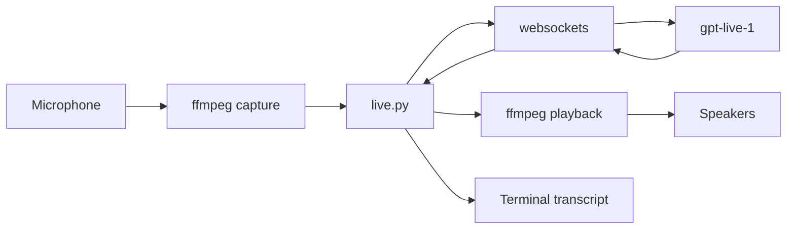
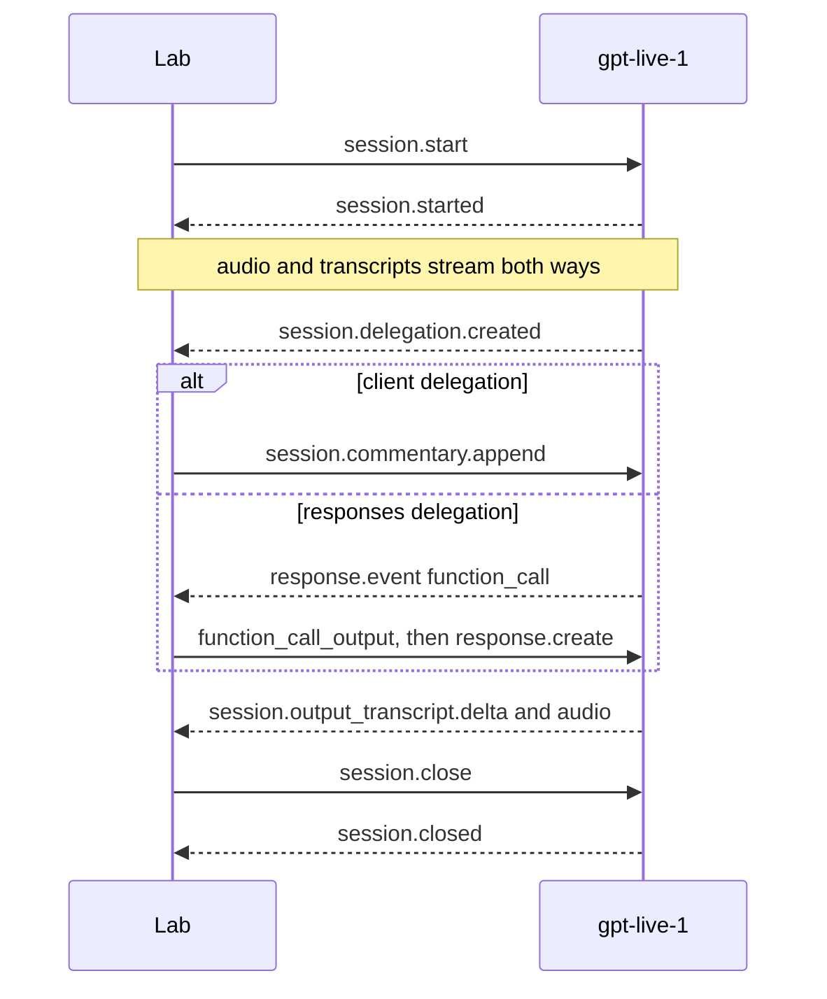

# GPT-Live lab

A session with OpenAI's live voice model, `gpt-live-1`. The desk agents in this repo talk to a chat-completions endpoint: one HTTP request per caller line, and `VoiceConversationAgent` owns the loop. GPT-Live is a different session. One WebSocket stays open. The model listens and speaks on that socket, and it hands work to a backend when the caller needs a lookup or a ticket.

This folder runs that session on its own. The desk agent and the desk tools stay where they are. The two functions that will call them later are named below.

The protocol is [GPT-Live over WebSocket](https://developers.openai.com/api/docs/guides/voice-websockets). Prompt shape is in [Prompting GPT-Live](https://developers.openai.com/api/docs/guides/live-prompting). Delegation is in [Delegation and tools](https://developers.openai.com/api/docs/guides/live-delegation).

## What each library does

The default command, `--plugin`, and `--self-check` use the Python standard library only. `--live` adds one Python package and one system program.

| Piece | Where it is used | What it owns |
| --- | --- | --- |
| Python standard library | Every file | JSON events, base64, threads, the microphone queue, the wav written at the end (`wave`), and the process launches (`subprocess`). |
| [`websockets`](https://websockets.readthedocs.io/) | `live.py`, only when you pass `--live` | The socket to `wss://api.openai.com/v1/live/sessions`. It sends and receives text frames. The events themselves are the JSON built in `contract.py` and `lab.py`. The package is already pinned in [requirements.txt](../requirements.txt). |
| `ffmpeg` | `live.py`, as a separate program | The microphone and the speakers. Python never opens a sound device. |
| `certifi` | `live.py`, if the virtualenv has it | The CA bundle for the socket handshake. A python.org macOS build otherwise has an empty certificate store. |

`ffmpeg` is doing two jobs, in two processes:

| Process | Command shape | Samples |
| --- | --- | --- |
| Microphone | `ffmpeg -f avfoundation -i :0` on macOS, or `-f pulse` elsewhere | Mono signed 16-bit little-endian PCM at 24 kHz, written to a pipe. `OPENAI_LIVE_AUDIO_DEVICE` picks the input. `0` is the first macOS input, which on this laptop is the built-in microphone. |
| Speakers | `ffmpeg -f audiotoolbox` on macOS, or `-f pulse` elsewhere | The same PCM, played at the spoken rate. Quiet is written between turns so the player stays open. |

Three threads share that work. The main thread is the only one that touches the socket. One thread reads the microphone pipe into a queue. One thread writes speaker PCM from another queue. `websockets`' synchronous client is not shared across threads.

## What each file owns

| File | Owns |
| --- | --- |
| `contract.py` | The `session.start` JSON, the instructions, and `input_audio_append`, which base64-encodes one PCM chunk. |
| `lab.py` | What to do when an event arrives. `Lab.handle` appends transcripts and, on a handoff, builds the reply event. `desk_commentary` and `search_knowledge` are the stand-ins for the desk. |
| `live.py` | The socket, the two `ffmpeg` processes, and printing each event as a short line. |
| `run.py` | The command line. `--live` calls `live.run_live`. Anything else plays `ScriptedServer` and never opens a socket. |

## The socket

A WebSocket is a phone call, where ordinary HTTP is a letter. The program opens `wss://api.openai.com/v1/live/sessions` with `Authorization: Bearer $OPENAI_API_KEY`. That first step is still HTTPS: the client asks to upgrade, the server agrees, and the same connection stays open. After that, either side can send a message at any time. There is no "response to this request" except the `event_id` you put on a command and the `client_event_id` the server echoes when it accepts it.

Each message is one JSON object in a text frame. The [`websockets`](https://websockets.readthedocs.io/) library does the upgrade, the framing, and the keepalive pings. `live.py` only sees strings. Audio is not a binary frame. It is base64 inside the JSON, because the socket is a stream of events and the samples are one field of an event.

Order on this connection is the order you can trust. Two events do not carry a shared clock except the transcript fields `start_ms` and `end_ms`, which are milliseconds from the start of the session. `session.output_audio.delta` has no timestamp. Play those chunks in the order they arrive.

Closing the TCP connection is not the end of the session. Send `session.close`, keep reading until `session.closed`, and only then drop the socket. The usage total lives on that last event.

Chat completions, which the desk agents use, is the other shape: one HTTPS POST, one JSON body, one reply, connection done. GPT-Live keeps the socket for the whole call.

## What the messages mean

`type` is the name of the message. The lines in the terminal are these names, shortened.

### Sent by this program

| `type` | Meaning |
| --- | --- |
| `session.start` | First message. Model, instructions, voice, audio format, delegation mode, and any text history. Nothing else is legal until `session.started`. |
| `session.input_audio.append` | One microphone chunk. `audio` is base64 PCM, no WAV header. The server does not answer this one. |
| `session.commentary.append` | A sentence the voice model should say, tied to a `delegation_id`. It paraphrases the text. |
| `session.thinking.append` | A fact the model may use later, without being asked to say it now. This lab does not send it. The same shape as commentary. |
| `session.close` | End the call. Sent on Ctrl-C. |

On the plugin path (`--plugin`), two more go out after a function call: `response.item.create` carries the tool result, and `response.create` tells the backend to continue. Appending the result alone does not resume it.

### Sent by the server

| `type` | Meaning | Printed as |
| --- | --- | --- |
| `session.started` | The session exists. `session.id` is the id. Audio may start. | `session.started` |
| `session.input_transcript.delta` | A fragment of what the model heard. Append `delta` in order. | `caller` |
| `session.output_audio.delta` | A fragment of the model's voice. `delta` is base64 PCM. | played, not printed |
| `session.output_transcript.delta` | The words in that voice. Append `delta` in order. | `voice` |
| `session.delegation.created` | The model is handing work over. `delegation.id` and `delegation.target`. The caller's sentence is not in this message. | `session.delegation.created` |
| `session.commentary.appended` | The commentary was accepted. `client_event_id` matches the `event_id` we sent. | `session.commentary.appended` |
| `session.usage.updated` | Running total of audio seconds so far. A later event replaces this number. | `audio_seconds` |
| `session.closed` | The call is finished. `reason` and the final `usage.seconds`. | `session.closed` |
| `error` | A command was rejected. `error.code`, `error.message`, and `client_event_id` when the bad command had an id. | `error` |
| `response.event` | One backend event wrapped up. Read `event.type` inside it. A function call arrives here as `response.output_item.done`. | `function_call` or `backend` |

A transcript `delta` is a piece of a sentence, not a turn. `" Hi,"` then `" thanks"` then `" for calling"` is one spoken line. The lab prints each piece as it arrives.

## Other write-ups

Official pages for this protocol:

| Page | What it walks through |
| --- | --- |
| [GPT-Live](https://developers.openai.com/api/docs/guides/live) | What the voice model does, and what the backend does |
| [WebSockets](https://developers.openai.com/api/docs/guides/voice-websockets) | Connect, `session.start`, and a Python client that reads PCM from stdin |
| [Primary WebSocket reference](https://developers.openai.com/api/reference/resources/live/primary-websocket) | Every client and server event on this socket |
| [Managing sessions](https://developers.openai.com/api/docs/guides/live-conversations) | Transcripts, history, commentary, thinking, and close |
| [Delegation and tools](https://developers.openai.com/api/docs/guides/live-delegation) | Client delegation versus a Responses backend, and returning a tool result |
| [Prompting](https://developers.openai.com/api/docs/guides/live-prompting) | The instruction headings the voice model expects |

The same event names on Azure, with a resource hostname instead of `api.openai.com`:

| Page | What it walks through |
| --- | --- |
| [Use GPT-Live](https://learn.microsoft.com/en-us/azure/foundry/openai/how-to/gpt-live) | A short WebSocket client and the `session.start` fields |
| [Event reference](https://learn.microsoft.com/en-us/azure/foundry/openai/gpt-live-reference) | The event list, field by field |
| [Delegate work](https://learn.microsoft.com/en-us/azure/foundry/openai/how-to/gpt-live-delegation) | Client and Responses delegation on Foundry |

Two neighboring protocols use different message names. A blog that says `input_audio_buffer.append` or `session.update` is the older [Realtime API](https://developers.openai.com/api/docs/guides/realtime-websocket), model `gpt-realtime`. This folder speaks GPT-Live: `session.start`, then `session.input_audio.append`.

The socket mechanism itself, apart from this API, is the [WebSocket protocol](https://developer.mozilla.org/en-US/docs/Web/API/WebSockets_API) and the [library this lab imports](https://websockets.readthedocs.io/en/stable/intro/index.html).

## One spoken call

`--live` is the path that uses the microphone and the speakers. The `caller` and `voice` lines are the transcript; the speakers play that same audio while the lines print.



1. `run.py` sees `--live` with no `--line` and calls `run_live(..., mic=True)`.
2. `_run_mic` starts the speaker `ffmpeg` first, so a greeting has somewhere to go. Then `websockets.sync.client.connect` opens `wss://api.openai.com/v1/live/sessions` with `Authorization: Bearer $OPENAI_API_KEY`.
3. `session_start` in `contract.py` is the first message. It names `gpt-live-1`, the voice `marin`, PCM at 24 kHz, client delegation, and a short instruction to greet and then listen. The model, the voice, the audio format, and the delegation mode stay fixed for the session.
4. The server answers `session.started`. `_start_mic` starts the capture `ffmpeg`. A thread reads about 100 ms at a time.
5. Each chunk goes out as `session.input_audio.append`. The audio field is base64 of the raw samples, with no WAV header. `input_audio_append` rejects an odd length, because each PCM16 sample is two bytes.
6. Events come back on the same socket.
   - `session.input_transcript.delta` is what the model heard. `Lab.handle` appends `delta`, and `live.py` prints it as `caller`.
   - `session.output_audio.delta` is the model's voice, again base64 PCM. `live.py` feeds it to the speaker `ffmpeg` in 20 ms steps. A burst is spread out, and silence fills the gap until the next utterance, because either one makes that `ffmpeg` exit.
   - `session.output_transcript.delta` is the words in that audio. It is printed as `voice`.
   - `session.usage.updated` carries cumulative audio seconds. Those snapshots are not added together.
7. When the model wants a lookup, it sends `session.delegation.created` with an id and `target: client`. The event has the id only. `Lab.heard` uses the transcript saved in step 6. `desk_commentary` returns a sentence, and the lab sends `session.commentary.append` with that same id. The model paraphrases the sentence into new audio and a new `voice` transcript.
8. Ctrl-C sends `session.close`. The server ends with `session.closed` and the final `usage.seconds`. Capture and playback processes are then stopped. The collected reply PCM is also written to a wav under the temp directory.

`--line` skips steps 4 and 5. The sentence is placed in `session.input` as text history. Text history is not speech, so the model stays quiet until audio arrives on the socket.

## Guidelines for voice data

A live call is a clock and a stream of integers. The practices below are what keep that stream recognizable as speech. This lab follows them in `live.py` and `contract.py`.

### Silence is the number zero, still on the clock

Each sample here is a signed 16-bit integer, two bytes, little-endian. The value `0` means the speaker cone does not move, so the room is quiet. One second of that is 24,000 zeros, or 48,000 zero bytes. The player writes 20 ms at a time, which is 960 bytes:

```python
frame = b"\x00" * (24_000 * 2 // 50)  # 960 zero bytes
```

`_write_player` sends one of these frames every 20 ms, starting when the speaker process opens. Speech bytes fill the frame when they are waiting. Zeros fill it the rest of the time, including before the first word:

```python
frame = pending + (b"\x00" * (PLAY_FRAME - len(pending)))
```

The sleep is the only wait, and it matches the length of the frame. An extra wait inside the loop feeds 20 ms of audio and then stalls, and the speaker process exits. That is the session where the reply was audible once and then gone.

### The bytes

| Rule | Why | In this lab |
| --- | --- | --- |
| Record the format in one place: rate, channels, width, endian. | Playing 16 kHz bytes at 24 kHz sounds fast and high. The bytes do not convert themselves. | 24 kHz, mono, signed 16-bit little-endian. `SAMPLE_RATE` in `contract.py`. |
| Keep every chunk an even number of bytes. | One sample is two bytes. A leftover byte is half a sample and shifts everything after it. | `input_audio_append` rejects an odd length. The mic reader carries a trailing byte into the next chunk. |
| Send raw samples on a live pipe. Put a header only on a file. | A WAV header in the stream is played as a click, then the rest is noise. | The socket and both `ffmpeg` pipes are raw PCM. `wave` adds the header when the reply is saved. |
| Encode for the socket, decode for the device. | The WebSocket frame is text. The device takes integers. | Base64 inside `session.input_audio.append` and `session.output_audio.delta`. |

Bytes per second is `rate × channels × bytes per sample`. Here that is `24000 × 1 × 2 = 48000`. A file's size divided by 48,000 is its duration in seconds.

### The clock

| Rule | Why | In this lab |
| --- | --- | --- |
| Capture and play at that byte rate. | A microphone already runs in real time. A speaker fed faster than real time overflows and quits. | Mic chunks are about 100 ms, as `ffmpeg` produces them. Playback sleeps 20 ms after each 960-byte write. |
| Spread a burst. Fill a gap with zeros. | Model audio arrives in clumps, then stops while the caller talks. Both the clump and the hole close AudioToolbox. | `_write_player` keeps a pending buffer and pads a short buffer with `b"\x00"`. |
| Bound the buffer. If you are late, drop the oldest audio. | An unbounded queue turns a stall into a reply that plays long after the moment has passed. | `PLAY_LIMIT` is 3 seconds. Older bytes are discarded. |
| Give the device one owner, and talk to it from one thread. | Two writers on one pipe interleave samples. | One thread writes the speaker pipe. One thread reads the mic pipe. The main thread alone uses the socket, through queues. |

### The session

| Rule | Why | In this lab |
| --- | --- | --- |
| Treat the transcript and the audio as two streams. | Printed words can be true while the speaker is already dead. Heard audio can be true while the transcript is still catching up. | `voice` is `session.output_transcript.delta`. The speaker gets `session.output_audio.delta`. The wav is the second stream, saved at hangup. |
| Let both sides talk at once, and keep the speaker out of the microphone. | This model is full duplex. A laptop speaker into its own mic makes the caller transcript contain the model's words, and the next answer is about that echo. | Headphones. The lab does not run echo cancellation. |
| Read a delegation for its id. The words are in the transcript you already stored. | `session.delegation.created` carries an id and a target. The caller's sentence is the transcript. | `Lab.heard` reads `input_transcript`. |
| Close the session and read until the terminal event. | Usage on `session.closed` is the final total. A socket that drops before that event leaves the total unknown. | Ctrl-C sends `session.close`. `_drain_until_closed` reads until `session.closed`. |
| Treat usage figures as snapshots. | `session.usage.updated` repeats the total so far. Adding the events counts the same audio again. | The printer shows `audio_seconds` as the latest value. |

## When the log moves and the audio does not

The model can be fine while the call is silent. `voice` lines and a rising `audio_seconds` mean speech is still arriving. The wav written at hangup is that same PCM. Divide its size by 48,000 to get seconds (24 kHz, 16-bit, one channel). If that file has the words you missed, the socket did its job and the local player or the microphone stopped.

These are the failures this lab already hit, and what it does now.

| What showed up | What had stopped | What the lab does |
| --- | --- | --- |
| `session.started`, then `audio_seconds=0.0`. Typing at the terminal did nothing. | No samples were sent. A sentence in `session.input` is history, and the program was not reading the keyboard or the microphone. | `--live` waits for `session.started`, then streams the microphone as `session.input_audio.append`. `--line` is the history-only path. |
| `caller` and `voice` lines printed. The speakers stayed quiet from the first word. | `ffplay` was the player. It exits at once on this build: `Failed to set value '1' for option 'ac'`. Its stderr was discarded, and the dead process still counted as playback, so the wav was not played at the end either. | The speaker process is `ffmpeg -f audiotoolbox` on macOS (`-f pulse` elsewhere). `ffplay` is not in the path. |
| The first reply was audible. Later `voice` lines kept printing, the caller said they could not hear, and the wav at hangup still held the whole reply (about 36 seconds in that run). | The speaker `ffmpeg` had stopped taking samples. AudioToolbox leaves the process when a burst arrives faster than it can play, and again when the writes pause: before the first word, between turns, or when the loop waits longer than the frame it just wrote. | `_write_player` writes one 20 ms frame every 20 ms from the moment the speaker opens. Speech fills the frame when it is buffered. Zeros fill it otherwise. If the process still exits, the lab starts it again, up to three times, and prints `Speaker stopped. Starting it again.` |
| The last line after Ctrl-C was `server session.output_audio.delta`, with no `session.closed`. | The hangup read one event. An audio chunk was still in flight, and that chunk was printed instead of being followed until the close finished. | `_drain_until_closed` keeps reading until `session.closed` or 15 seconds. |

Two more local checks, from the same sessions:

- The microphone process exits immediately when macOS has not allowed the terminal under System Settings → Privacy & Security → Microphone. The lab prints that path. `OPENAI_LIVE_AUDIO_DEVICE` is the avfoundation index if the built-in mic is not device `0`.
- With speakers on, the microphone hears the reply. The `caller` line then contains the model's own words, and the next answer is about that echo. Headphones keep the reply out of the capture.

`session.usage.updated` is a running total of audio seconds. A later value replaces the earlier one. Adding them counts the same audio twice.

## The interface another program calls

The microphone, the 20 ms clock, the zeros, and the socket stay in this folder. Another program does not open a sound device and does not parse PCM. It supplies one function, called when GPT-Live delegates:

```text
microphone and speaker  ->  live.py  ->  transcript
                                ^              |
                                |              v
                         commentary text  <-  your agent
```

```python
def on_delegation(transcript: str) -> str:
    reply = desk.handle_utterance(transcript)
    return reply.text
```

`live.py` turns that string into `session.commentary.append` with the delegation id. GPT-Live is the voice. It paraphrases the string and plays the audio. The agent does not run a second text-to-speech pass on the same words.

The LangGraph desk does this in [single_agent_langgraph/live_voice.py](../single_agent_langgraph/live_voice.py). That file is the whole integration. The audio modules stay here and are imported. `desk` is a `LangGraphDesk`. Its graph keeps its own model and its own tools. GPT-Live is only the mouth and ears. `handle_utterance` already redacts, runs the tools, and returns `SpeechReply.text`. The checkpoint key stays the Live session id.

```bash
OPENAI_API_KEY=... .venv/bin/python single_agent_langgraph/run.py --voice
```

Rules for that callback, in any program:

| Do this | Why |
| --- | --- |
| Call it from the socket loop, on `session.delegation.created`. | A transcript fragment is not a finished request. The delegation event is the handoff. |
| Pass the transcript you saved, not the event body. | The event has an id and a target. The caller's words are the `caller` deltas. |
| Return one plain sentence. | That sentence is what the voice model will say. Ticket ids and tool JSON stay in the agent. |
| Keep tools, confirmation, and redaction inside the agent. | The voice model does not open tickets. `create_incident` still requires `confirmed=true` in the desk code. |
| Ignore a second callback with an id you already answered. | The model can delegate again for a new sentence. The same id is the same task. |
| Leave the mic thread and the speaker thread alone. | They move PCM. The agent runs where the socket events are handled. |

Client delegation is the seam for an agent you already run. Responses delegation is the seam for a single function, the plugin path in `--plugin`. A LangGraph desk is the first one: the graph is the backend, and the Live session does not also grow a tool list.



`session.delegation.created` is the handoff in both branches. The caller text stays in the transcript. The next section is what this program sends back.

## Two places to attach later

| Mode | Who does the work | What this lab sends back | Later call |
| --- | --- | --- | --- |
| `client` | This program | `session.commentary.append` with the delegation id. The model paraphrases that text aloud. | `Lab._on_delegation` calls the desk agent |
| `responses` | A Responses model, then a function in this program | `response.item.create` with `function_call_output`, then `response.create` so the backend continues | `Lab._tool_output` calls one desk tool |

Client delegation is the agent seam. The live model keeps the conversation. The application runs whatever agent it already has, then gives the voice model a sentence to say. `session.thinking.append` is the quieter variant: a fact the model may use later, without being asked to say it now.

Responses delegation is the plugin seam. The live model delegates to a Responses model. That model emits a `function_call` inside `response.event`. This program runs the function and sends the result back. The function schema is flat (`name` at the top). The chat-completions tools in `single_agent/voice_agent.py` nest that same schema under `function`.

`desk_commentary` and `search_knowledge` in `lab.py` are the stand-ins. Both know the VPN article from the desk sandbox. Neither opens a ticket.

## Run

The scripted traces use the standard library. `--live` needs the `websockets` package pinned in [requirements.txt](../requirements.txt).

```bash
python3 chatgpt_live/run.py                  # scripted client delegation, no API key
python3 chatgpt_live/run.py --plugin         # scripted function call
python3 chatgpt_live/run.py --self-check
python3 chatgpt_live/run.py --show-contract  # both session.start payloads
```

`--live` opens the microphone and plays the reply through the speakers as the model speaks. The `voice` lines in the terminal are the transcript of that audio. Wait for `Speak now`, then talk. Ctrl-C hangs up. Use headphones so the reply is not picked up by the microphone. The first time, macOS asks for microphone access for the terminal.

```bash
uv venv --python 3.12 .venv
uv pip install -r requirements.txt
OPENAI_API_KEY=... .venv/bin/python chatgpt_live/run.py --live
```

`--line` skips the microphone and sends that sentence as text history. Text history is not speech, so that session stays quiet until something is spoken on the socket.

```bash
.venv/bin/python chatgpt_live/run.py --live --line "Email will not sync" --no-play
.venv/bin/python chatgpt_live/run.py --live --verbose
```

`OPENAI_LIVE_AUDIO_DEVICE` selects the input. On macOS it is the ffmpeg avfoundation audio index (`0` is the built-in microphone when it is listed first). Elsewhere it is a PulseAudio source name.

| Variable | Default |
| --- | --- |
| `OPENAI_LIVE_URL` | `wss://api.openai.com/v1/live/sessions` |
| `OPENAI_LIVE_MODEL` | `gpt-live-1` |
| `OPENAI_LIVE_VOICE` | `marin` |
| `OPENAI_LIVE_AUDIO_DEVICE` | `0` on macOS, `default` on PulseAudio |
| `OPENAI_LIVE_BACKEND_MODEL` | `gpt-5.6-luna`, used only in the responses `session.start` |

The websocket quickstart names `gpt-5.6-luna` for the Responses backend. The delegation guide also says to start with `gpt-6-luna`. Check the current name before a live plugin session. The scripted `--plugin` trace does not call that model.

## What a live call still leaves to the desk

The scripted server repeats the commentary as the spoken transcript. A live model paraphrases it and sends audio. `--live` streams `session.input_audio.append` from the microphone and uses the stand-in sentence when the model delegates. Wiring `VoiceConversationAgent` into `Lab._on_delegation`, and a desk tool into `Lab._tool_output`, is the next change.
