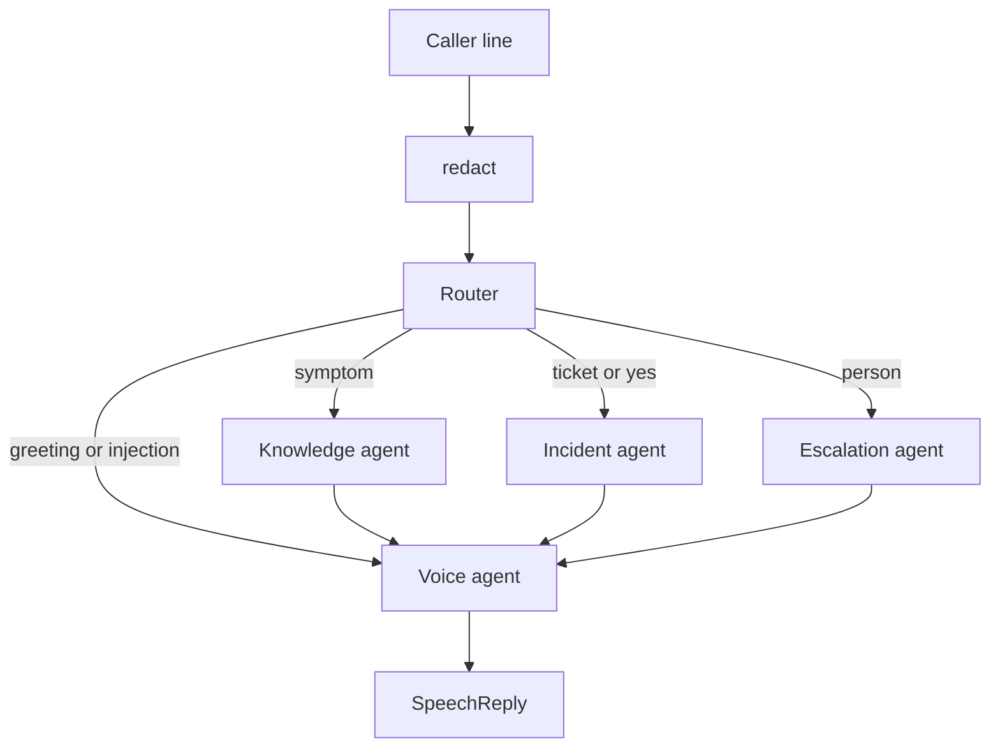

# Multi-agent desk

Same caller, same sandbox, same two-turn VPN call as [single_agent/](../single_agent/). The work is split by who is allowed to do it.

`python3 multi_agent/run.py --self-check` asserts that the spoken lines and the tool trace match `ScriptedModel` in the single agent.

## Why split

The single agent has one prompt and four tools. A knowledge lookup is finished when an article comes back. Opening a ticket is finished only after the caller agrees. A transfer is finished when the caller leaves the bot. Those are different stop conditions and different permissions, so each one is an agent with its own prompt and its own handler map.

```text
caller transcript
    redact
    router          one word: knowledge, incident, escalation, or voice
    specialist      its own tools only, then a result dict
    voice           the only text the caller hears
```



| Agent | Prompt | Tools | Finished when |
| --- | --- | --- | --- |
| Router | `ROUTER_PROMPT` | None | One of the four route words |
| Knowledge | `KNOWLEDGE_PROMPT` | `search_knowledge` | An article, or an empty list |
| Incident | `INCIDENT_PROMPT` | `get_incident`, `create_incident` | A ticket, or one question asking the caller to agree |
| Escalation | `ESCALATION_PROMPT` | `escalate` | `transferred: true` |
| Voice | `VOICE_PROMPT` | None | One or two sentences |

The prompts are the single-agent `SYSTEM_PROMPT` cut along the sections in [PROMPT.md](../PROMPT.md). Speech rules stay on the voice agent. Tool rules stay on the specialist that owns that tool.

## What one turn does

`DeskSession.handle_utterance` in `session.py`:

1. `redact` runs first. The model never sees the raw secret. This is the same function as the single agent.
2. The harness sets `caller_agreed` from the latest line. The phrases are the ones `ScriptedModel` treats as a yes: "yes", "go ahead", "open it", "please do".
3. The router returns one route. In `--demo` that router is Python (`RuleRouter`), because those branches are closed and they match `ScriptedModel`. In `--live` a model returns the same four words and calls no tools.
4. The specialist starts a fresh message list: its prompt, plus one JSON user message (the handoff). It does not see the rest of the call.
5. `Specialist.run` is the same propose, allow-list, act, stop loop as `handle_utterance`. The handler map is only that specialist's tools. A knowledge model that asks for `create_incident` gets `unknown_tool`.
6. On `create_incident`, the loop overwrites `confirmed` with `caller_agreed`. The model's boolean is ignored. The sandbox still rejects anything other than `true`.
7. The voice agent turns the result dict into speech. `--demo` uses the same sentences as `ScriptedModel`, then `normalize_speech`. `--live` asks a model, with no tools, to speak from that dict.

## How to read a --live router trace

`--verbose` prints two JSON blocks for the router. Only the first one comes from the model.

The model returns a chat completion whose `message.content` is one word. For "My VPN will not connect" that word is `knowledge`. `ROUTER_PROMPT` defines `knowledge` as a reported symptom. The line is not `incident` (no ticket id and no yes), not `escalation` (the caller did not ask for a person), and not `voice` (the greeting shares the line with the symptom). The reply is one token because the prompt says to answer with one word.

```json
"message": { "role": "assistant", "content": "knowledge" }
```

`# Tools` inside `ROUTER_PROMPT` is a prompt heading, the same section name as in [PROMPT.md](../PROMPT.md). Those four lines say when to choose each route word. `ModelRouter` calls `complete(messages, [])`, so the HTTP request has no `tools` array. The model cannot emit a tool call named `knowledge`.

The next block is printed by `DeskSession` after `parse_route` reads that word:

```text
----- route -----
{ "route": "knowledge", "utterance": "...[REDACTED_SSN]...", "facts": { "caller_agreed": false } }
```

The model does not produce this object. `utterance` is the caller line after `redact`. `facts` is the harness state for this call.

The knowledge agent is not a tool of the router. The session starts that agent next. Its model may then call `search_knowledge`, and the code runs `desk.search_knowledge`. A tool call runs a desk function. It does not start another agent.

The demo call:

```text
caller> Hi, this is Alex. My VPN will not connect ...
route > knowledge
agent > You are tight on time. Quit the VPN client, ...
tools > search_knowledge

caller> Yes, open it.
route > incident
agent > I opened I N C, 0 0 1, 0 0 0, 2 as high urgency. ...
tools > create_incident
```

## Where to read

| File | What it is |
| --- | --- |
| `contracts.py` | `CallFacts`, `Handoff`, `SpecialistResult`. The only objects agents pass. |
| `prompts.py` | One prompt per role |
| `router.py` | `RuleRouter` and `ModelRouter` |
| `specialist.py` | The tool loop. This is the part a framework would hide. |
| `voice.py` | Scripted sentences for the demo, and `ModelVoice` for `--live` |
| `scripted.py` | `complete()` stand-in for each specialist, parallel to `ScriptedModel` |
| `session.py` | One utterance: route, specialist, speak |
| `single_imports.py` | Pulls in the sandbox, the client, `redact`, and `normalize_speech`. Nothing here is copied. |
| `run.py` | CLI and the checks |

## What stayed in the single agent

| Piece | Where it still lives |
| --- | --- |
| HTTP client, retries, verbose JSON | `single_agent/model_client.py` |
| Redaction and spoken ticket ids | `single_agent/agent.py` |
| Tool schemas and `ServiceNowSandbox` | `single_agent/voice_agent.py` |
| Step cap of 4 | `MAX_STEPS`, imported by the specialist |

Each specialist may take up to 4 model calls. The session routes once per caller line. The single agent can search and then escalate inside one line, because one loop holds every tool. Here a second job waits for the next line, unless it is one of the tools that specialist already owns.

## Run

From the repo root:

```bash
python3 multi_agent/run.py --demo
python3 multi_agent/run.py --self-check
python3 multi_agent/run.py --demo --verbose   # handoff, each model payload, each tool result
python3 multi_agent/run.py --demo --audit
OPENAI_API_KEY=... python3 multi_agent/run.py --live
```

`--self-check` covers four things the single-agent check does not need to separate:

- The demo speech and tool list match the single agent.
- A model that only calls `list_all_users` stops after 4 steps and does not run that function.
- `create_incident` with `confirmed=true` does not write a ticket when this line was not an agreement.
- The knowledge agent cannot open a ticket, because `create_incident` is not in its handler map.

## Would LangChain or LangGraph make this shorter?

No. The multi-agent program is longer than the single-agent loop, and both libraries leave the long parts in place.

Line counts of the Python in this repo:

| | Lines |
| --- | --- |
| `single_agent/` (loop, client, prompt, sandbox, CLI) | 755 |
| `multi_agent/` (roles, prompts, handoff, CLI, checks) | 876 |

The multi-agent folder is 876 lines because it adds a router, three prompts, a voice prompt, a handoff object, and a scripted model per role. It reuses the 755 lines. It does not reimplement the sandbox or the HTTP client.

What a library can delete is the branch, not the desk.

| Piece | Lines | LangChain | LangGraph |
| --- | --- | --- | --- |
| `prompts.py` | 92 | Still yours. A `ChatPromptTemplate` is longer. | Still yours |
| `contracts.py` | 67 | Still yours | A `TypedDict` state object is about the same size |
| `specialist.py` tool loop | 122 | `create_tool_calling_agent` plus `AgentExecutor` replaces the `for` loop | `ToolNode` plus `tools_condition` replaces the `for` loop |
| `router.py` | 55 | Still yours. The agent executor is one agent, not a router. | The rule router stays. A conditional edge replaces the `if route ==` branch in `session.py` |
| `voice.py` | 79 | Still yours | Still a node you write |
| `scripted.py` | 65 | Still yours. A fake LangChain chat model is longer than `complete()` | Still yours |
| `session.py` | 133 | Still yours | `StateGraph`, nodes, and `compile` replace `handle_utterance` and land in the same range |
| Sandbox, `redact`, `normalize_speech`, confirmation | in `single_agent/` | Still yours. The confirmed overwrite moves inside the tool wrapper | Still yours |
| `model_client.py` | 139 | `ChatOpenAI` can replace this file | Same |

The specialist loop is the attractive deletion. It is a `for` of at most 4 steps: call `complete`, reject unknown names, overwrite `confirmed`, append the tool message. An executor hides that. You then write the same guards again as a tool wrapper, a callback for the audit log, and a parser that turns the framework's message list back into a `SpecialistResult`. That wrapper is the size of the loop it replaced. You also take on `langchain-core` and a chat-model package, and `--demo` needs a fake model that speaks that package's message objects.

LangGraph replaces `DeskSession.handle_utterance` with a graph. A minimal graph for this desk is a state dict, five node functions, and four edges into the voice node. The node functions still call the router, the specialist, and the voice agent. The edge list is shorter than the `if`. The state class and the `compile` step put the total back next to `session.py` (133 lines). Checkpointing, which is the feature the graph adds, is more code on top: a checkpointer and a thread id. This demo does not pause or resume, so that code would be new, not removed.

The single-agent loop in `single_agent/agent.py` is 155 lines. Pointing LangChain at that one loop removes the `for` and keeps the prompt, the four handlers, redaction, and `normalize_speech`. The file gets smaller by a few dozen lines and the allow-list moves inside the framework, which is the seam [PRODUCTION.md](../PRODUCTION.md) says to keep visible so a barge-in can cancel one model call.

Use LangGraph when a turn must pause on the confirmation question and resume after a crash, or when the route itself has to be stored and replayed. [PRODUCTION.md](../PRODUCTION.md) already draws that line. For the call this folder runs, the plain functions are the shorter program.
