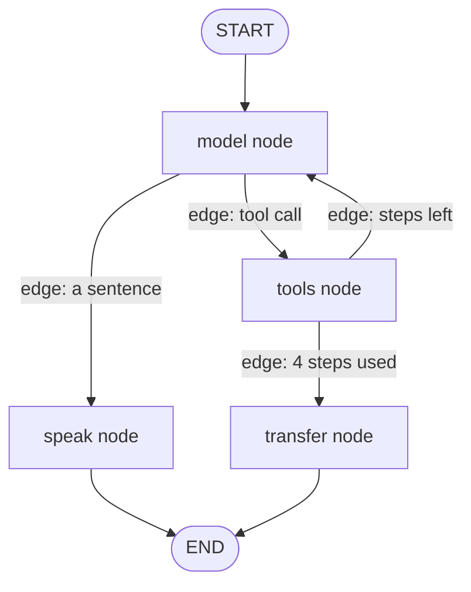

# LangGraph in one page

Read this before [FLOW.md](FLOW.md). That note walks this desk's graph. This note is the vocabulary: state, node, edge, compile, invoke.

LangGraph is a library for writing a flowchart in Python and then running it. The flowchart can loop. It can remember the last run. The model, the prompt, and the tools are ordinary Python inside the boxes. LangGraph is the arrows between the boxes.

This desk's flowchart is in `graph.py`. Four boxes, two decisions, one loop.



## The four words

| Word | Plain meaning | In this desk |
| --- | --- | --- |
| State | The notepad every box can read. A dict. | `DeskState`: messages, steps, tools used, escalated, audit |
| Node | One box. A function. It reads the notepad and returns the lines it wants to change. | `model_node`, `tools_node`, `speak_node`, `transfer_node` |
| Edge | The arrow. It names which box runs next. The box itself does not call the next box. | `add_edge`, and `after_model` / `after_tools` |
| Compile | Freeze the drawing so it can be run. Also where memory is attached. | `builder.compile(checkpointer=InMemorySaver())` |

`START` and `END` are not functions. `START` is the entrance. `END` is the exit. `add_edge(START, "model")` means every run begins at the model box.

## What a node does

A node is a function with this shape: take the current state, return a dict of updates.

```python
def model_node(state: DeskState) -> dict:
    response = model.invoke(state["messages"])
    return {"messages": [response], "steps": state["steps"] + 1}
```

`model_node` calls the model. It does not call `tools_node`. When it returns, LangGraph applies the update to the notepad, then looks at the edges out of `"model"` to pick the next function.

A node may return only the keys it changed. The other keys stay as they were.

## What an edge does

An edge is the routing. There are two kinds.

A normal edge is a fixed arrow. After `speak`, the run always ends.

```python
builder.add_edge("speak", END)
builder.add_edge(START, "model")
```

A conditional edge is a function that looks at the notepad and returns the name of the next node. After `model`, `after_model` returns `"tools"` or `"speak"`.

```python
def after_model(state: DeskState) -> Literal["tools", "speak"]:
    last = state["messages"][-1]
    if last.tool_calls:
        return "tools"
    return "speak"

builder.add_conditional_edges("model", after_model)
```

The string it returns must be a node name you already added, or `END`. That is the whole decision. There is no extra router object.

This desk uses a conditional edge where the plain loop used `if`. `if turn.tool_calls` became `after_model`. `if steps >= 4` became `after_tools`. The reply is turned into that string in [FLOW.md](FLOW.md#how-a-reply-picks-the-next-node).

## How a run moves

`graph.invoke(input, config)` starts at `START` and follows edges until `END`.

1. LangGraph merges `input` into the notepad.
2. It runs the next node.
3. It applies that node's dict onto the notepad.
4. If a checkpointer was passed to `compile`, it saves the notepad.
5. It follows the edge and repeats from step 2.

One caller line is one `invoke`. The demo's first line walks `model`, `tools`, `model`, `speak`. The second line walks the same path with a different tool. Both walks use the graph that was compiled once.

## State, and why some keys append

`StateGraph(DeskState)` is told the shape of the notepad up front. Each key can also say how two values combine.

| Key | How an update is applied | Why |
| --- | --- | --- |
| `messages` | Append, and replace a message when the id matches | The conversation grows. `speak` rewrites the sentence it just got. |
| `audit` | Append | Events from the whole call stay in one list. |
| `steps`, `tools_used`, `escalated` | Replace | Each caller line starts these at 0, `[]`, and false. |

The append behavior is a reducer. `add_messages` is the reducer for `messages`. `operator.add` is the reducer for `audit`. A key with no reducer is replaced by whatever the node returned.

The model and the handler map are not in the notepad. The node functions close over them when `build_graph` is called. The notepad holds what changes during a call.

## Memory

`compile(checkpointer=InMemorySaver())` saves the notepad after each node. The save is keyed by `thread_id`. This desk uses `"call"`.

```python
self.config = {"configurable": {"thread_id": "call"}}
out = self.graph.invoke(incoming, self.config)
```

The next `invoke` with that same `thread_id` loads the previous notepad first, then merges the new input. That is why the second caller line still sees the system prompt and the knowledge-base answer. `InMemorySaver` lives in the process. When the process exits, the notepad is gone. A database checkpointer is the same idea with a durable store. This folder does not use one.

## Where this sits next to the plain loop

`VoiceConversationAgent.handle_utterance` is a `for` loop that calls the model, maybe runs a tool, and returns a sentence. The graph is that `for`, drawn as boxes.

| Plain loop | LangGraph name |
| --- | --- |
| `self.messages` and `self.audit` | State |
| The body of one step | A node |
| `if tool_calls` / `if steps >= 4` | A conditional edge |
| The list living on the agent object | A checkpoint under `thread_id` |
| `handle_utterance(...)` | `graph.invoke(...)` |

`create_agent` in LangChain builds a graph like this for you: a model node, a tools node, and an edge back until the model stops asking for tools. `graph.py` writes the nodes so the allow-list, the 4-step cap, and `normalize_speech` stay visible. The one-call version is in [README.md](README.md).

## What to read next

This repo, in order:

| Note | What it adds |
| --- | --- |
| [FLOW.md](FLOW.md) | This graph being built, then the two demo lines node by node |
| [README.md](README.md) | How to run it, and the `create_agent` shortcut |
| [../FLOW.md](../FLOW.md) | The same call as a `for` loop, including tool JSON |
| [../PATTERNS.md](../PATTERNS.md) | Other shapes, and where a checkpoint fits in production |

Upstream docs. Start at the overview, then the quickstart, which builds a tool loop close to this one.

| Topic | Where |
| --- | --- |
| What LangGraph is | [Overview](https://docs.langchain.com/oss/python/langgraph/overview) |
| A tool loop, written as nodes and edges | [Quickstart](https://docs.langchain.com/oss/python/langgraph/quickstart) |
| How to choose the boxes before you write them | [Thinking in LangGraph](https://docs.langchain.com/oss/python/langgraph/thinking-in-langgraph) |
| State, nodes, edges, `START`, `END`, compile | [Graph API overview](https://docs.langchain.com/oss/python/langgraph/graph-api) |
| The same API, as a worked tutorial | [Use the graph API](https://docs.langchain.com/oss/python/langgraph/use-graph-api) |
| `thread_id`, checkpoints, and the store | [Persistence](https://docs.langchain.com/oss/python/langgraph/persistence) |
| `InMemorySaver` and `PostgresSaver` | [Checkpointers](https://docs.langchain.com/oss/python/langgraph/checkpointers) |
| Pause on a question and resume | [Interrupts](https://docs.langchain.com/oss/python/langgraph/interrupts) |
| `StateGraph` methods | [StateGraph reference](https://reference.langchain.com/python/langgraph/graph/StateGraph) |
| The prebuilt loop, `create_agent` | [Agents](https://docs.langchain.com/oss/python/langchain/agents) |

Upstream writing, from the LangChain blog:

| Post | Why read it |
| --- | --- |
| [How to think about agent frameworks](https://www.langchain.com/blog/how-to-think-about-agent-frameworks) | Nodes are units of work. Edges are transitions. The path can still change at runtime. |
| [Building LangGraph](https://www.langchain.com/blog/building-langgraph) | Why the library is a low-level runtime: control, checkpoints, and streaming, rather than a hidden agent loop. |
| [LangGraph: Multi-Agent Workflows](https://www.langchain.com/blog/langgraph-multi-agent-workflows) | The same boxes and arrows with one agent per node. The router in [../multi_agent/](../multi_agent/) is that idea in plain Python. |
