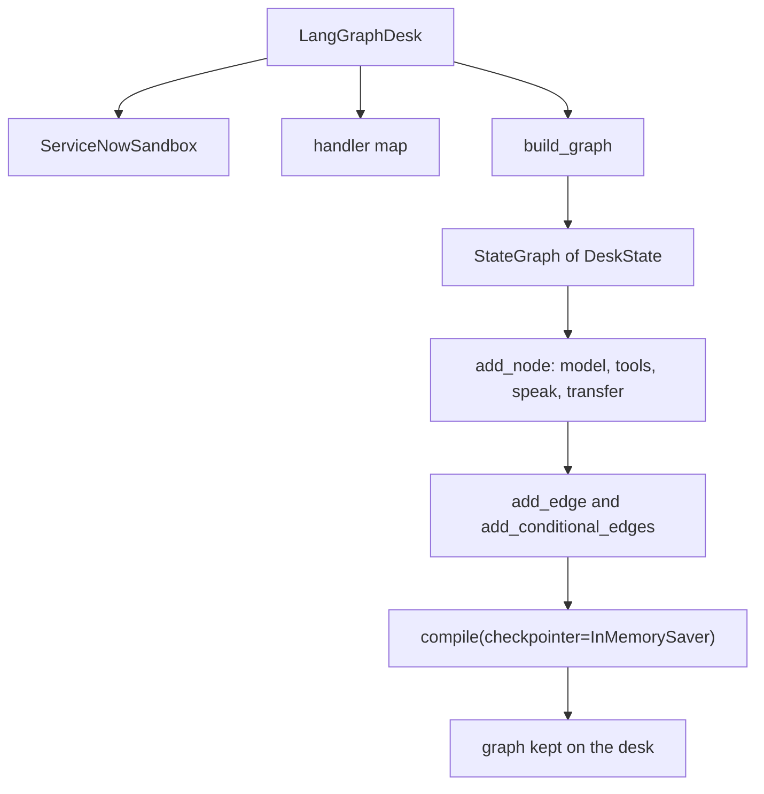
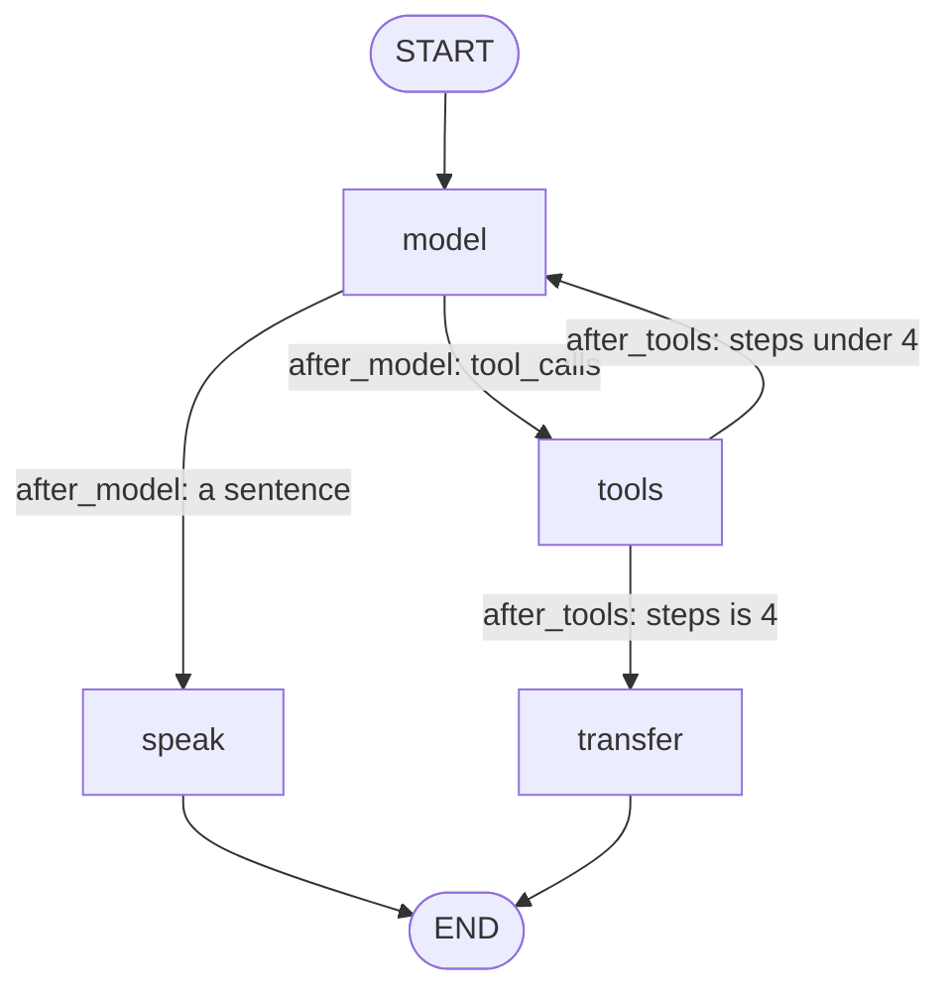

# One LangGraph call, node by node

This trace is the single-agent program in `single_agent_langgraph/`. Run it with `.venv/bin/python single_agent_langgraph/run.py --demo`. Add `--calls` to print only the function list: `start` and `end` for each function, then one `walk:` line from the caller back to the caller. The words node, edge, state, and compile are defined in [CONCEPTS.md](CONCEPTS.md). The plain `for` loop this graph replaces is in [FLOW.md](../FLOW.md). Roles, `tool_calls`, and the Chat Completions JSON are explained there. This note is how the graph is built, and then how one caller line moves through it.

## The short version

The graph is built once, when `LangGraphDesk` is created. A caller line does not build it again. Each line calls `graph.invoke` on the graph that already exists.

Building does five things:

1. Name the state. `DeskState` is the dict every node reads and returns updates for.
2. Add four nodes: `model`, `tools`, `speak`, `transfer`. A node is a function.
3. Add edges. `START` always enters `model`. After `model` and after `tools`, a small function picks the next node.
4. Compile. `compile` checks the edges and attaches `InMemorySaver`.
5. Keep that compiled graph on the desk, with `thread_id` `"call"`.

Then, for each line you type:

1. `redact` hides secrets before `invoke`. The checkpointer stores the input, so the secret has to be gone already.
2. The first line also sends the system prompt. Later lines send only the new caller text. The checkpoint still holds the earlier messages.
3. `model` calls the model. A tool request goes to `tools`, then back to `model`. A sentence goes to `speak`, and the graph ends.
4. At 4 model calls that are still asking for tools, `tools` goes to `transfer` instead of `model`.

## How the graph is created

`main` in `run.py` builds one `LangGraphDesk`. For `--demo` the model is `ScriptedChatModel`. For `--live` it is `ChatOpenAI` with the four tool schemas bound. `build_graph` is the same either way.

```text
main                         single_agent_langgraph/run.py
  LangGraphDesk              single_agent_langgraph/graph.py
    ServiceNowSandbox        single_agent/voice_agent.py
    handlers                 four names to four desk methods
    build_graph              single_agent_langgraph/graph.py
      StateGraph(DeskState)
      add_node               model, tools, speak, transfer
      add_edge               START to model, speak to END, transfer to END
      add_conditional_edges  model via after_model, tools via after_tools
      compile                InMemorySaver
```



The nodes close over `model` and `handlers`. Those two objects are not fields of `DeskState`. The state is only what changes while a line runs.

| Piece | Where it is set | What it is |
| --- | --- | --- |
| `DeskState` | the class above `build_graph` | `messages`, `steps`, `tools_used`, `escalated`, `audit` |
| `model` node | `add_node("model", model_node)` | Calls `model.invoke` and adds 1 to `steps` |
| `tools` node | `add_node("tools", tools_node)` | Runs each tool call through the handler map |
| `speak` node | `add_node("speak", speak_node)` | `normalize_speech`, then replaces the model sentence |
| `transfer` node | `add_node("transfer", transfer_node)` | The handoff sentence after 4 tool steps |
| `after_model` | `add_conditional_edges("model", after_model)` | `tools` when the reply has `tool_calls`, otherwise `speak` |
| `after_tools` | `add_conditional_edges("tools", after_tools)` | `transfer` when `steps` is already 4, otherwise `model` |
| Checkpointer | `compile(checkpointer=InMemorySaver())` | Saves state after each node, under `thread_id` |

`add_edge(START, "model")` is a fixed edge. Every `invoke` enters `model`. `after_model` and `after_tools` are the branches. They return the name of the next node. `speak` and `transfer` both use `add_edge(..., END)`, so either one finishes the line.



`messages` and `audit` use a reducer. A node returns the new items, and LangGraph appends them to what is already stored. `steps`, `tools_used`, and `escalated` have no reducer. The value returned by a node, or passed into `invoke`, replaces the old one.

Compile happens once. The sandbox and the handler map are also created once. The next caller line reuses them.

## How a reply picks the next node

The model returns one `AIMessage`. It does not return a node name. `model_node` stores that message and adds 1 to `steps`. LangGraph then calls `after_model`. That function reads the message just stored and returns the name of the next node as a string. LangGraph runs the node with that name.

```text
model.invoke(state["messages"])
    returns an AIMessage
model_node returns {"messages": [that AIMessage], "steps": steps + 1}
LangGraph appends the AIMessage, then calls after_model(state)
    last.tool_calls is a non-empty list  →  "tools"
    last.tool_calls is missing or []      →  "speak"
LangGraph runs the node named by that string
```

`after_model` is only that check:

```python
def after_model(state: DeskState) -> Literal["tools", "speak"]:
    last = state["messages"][-1]
    if getattr(last, "tool_calls", None):
        return "tools"
    return "speak"
```

An empty list is false in Python, same as a missing list, so a sentence goes to `speak`.

| What the model meant | What is on the AIMessage | `after_model` returns |
| --- | --- | --- |
| Call a tool | `tool_calls` is `[{name, args, id}]`. `content` is often empty. | `"tools"` |
| Say a sentence | `content` is the sentence. `tool_calls` is `[]`. | `"speak"` |

`--demo` has one conversion before that check. `ScriptedModel.complete` returns a `ModelTurn`. `ai_message_from_turn` in `model.py` copies it onto the `AIMessage` that `after_model` reads.

```text
ModelTurn(content=None, tool_calls=[ToolCall("call_kb", "search_knowledge", {...})])
    → AIMessage(tool_calls=[{"name": "search_knowledge", "args": {...}, "id": "call_kb"}])
    → after_model returns "tools"

ModelTurn(content="You are tight on time. ...", tool_calls=[])
    → AIMessage(content="You are tight on time. ...")
    → after_model returns "speak"
```

`--live` skips that adapter. `ChatOpenAI` already returns the `AIMessage`, with the API's `tool_calls` array copied onto `AIMessage.tool_calls`. `after_model` is the same function either way.

## How the loop repeats

`tools_node` appends a `ToolMessage` and returns. It does not call the model. LangGraph then runs `after_tools`, which reads `steps`. That number was already incremented inside `model_node`.

```text
steps is 1, 2, or 3  →  return "model"      model_node runs again
steps is 4           →  return "transfer"   then END
```

Returning `"model"` is the loop. The next `model.invoke` sees the whole list, including the new `ToolMessage`. On `--demo`, `ScriptedModel._reply` sees `role == "tool"`, writes a sentence, and sets `tool_calls` to `[]`. That empty list is why the second pass goes to `speak` and the walk stops.

A line that uses one tool walks `model` twice:

```text
START
  model    tool_calls = [search_knowledge]     steps = 1
  tools    ToolMessage appended (the article)
  model    content = "You are tight on time. ..."
           tool_calls = []                     steps = 2
  speak    normalize_speech
END
```

`speak` and `transfer` use a fixed edge to `END`. The caller line is over when one of those two nodes finishes.

A line with no tool is shorter. The first `AIMessage` is already a sentence, `after_model` returns `"speak"`, and `tools` never runs.

## What a caller line does

`run_turns` calls `handle_utterance` once per line. That method does not walk the nodes itself. It prepares the input and calls `graph.invoke`. The compiled edges walk the nodes.

```text
run_turns                    single_agent_langgraph/run.py
  handle_utterance           single_agent_langgraph/graph.py
    redact                   single_agent/agent.py
    graph.invoke
      model_node             model.invoke
        ScriptedChatModel    single_agent_langgraph/model.py
          ScriptedModel      single_agent/voice_agent.py      on --demo
        ChatOpenAI           langchain_openai                 on --live
      after_model
      tools_node
        _run_handler         handler map to ServiceNowSandbox
      after_tools
      model_node             second call, now with the tool result
      after_model
      speak_node
        normalize_speech     single_agent/agent.py
```

On `--live`, `ChatOpenAI.bind_tools(TOOLS)` replaces `ScriptedChatModel`. `model_node` still calls `invoke`. The tool schemas go out with that client. On `--demo`, `ScriptedChatModel._generate` turns the LangChain messages into the dicts `ScriptedModel.complete` already understands, then turns the `ModelTurn` back into an `AIMessage`.

| LangChain message | Chat Completions role | Who writes it |
| --- | --- | --- |
| `SystemMessage` | `system` | `handle_utterance`, on the first line only |
| `HumanMessage` | `user` | `handle_utterance`, after `redact` |
| `AIMessage` | `assistant` | `model_node`, or `speak_node` when it rewrites the sentence |
| `ToolMessage` | `tool` | `tools_node`, with the same `tool_call_id` |

`_run_handler` looks up `call["name"]` in the map filled in `LangGraphDesk.__init__`:

| Name on the tool call | Method that runs |
| --- | --- |
| `search_knowledge` | `desk.search_knowledge` |
| `get_incident` | `desk.get_incident` |
| `create_incident` | `desk.create_incident` |
| `escalate` | `desk.escalate` |

A name that is missing returns `{ok: false, error: unknown_tool}`. The desk method does not run. After 4 such model calls, `after_tools` sends the graph to `transfer`.

## The same steps for every line

1. `redact` looks for an SSN, a card number, or a password. Labels become an audit event. The cleaned text is the `HumanMessage`.
2. The first line also puts `SYSTEM_PROMPT` in a `SystemMessage`. `_seeded` stops that from happening again. The checkpoint keeps it.
3. `invoke` is given `steps: 0`, `tools_used: []`, and `escalated: False`. Those three replace the previous line's values. `messages` and `audit` are appended.
4. `model_node` sends the message list to the model and stores the `AIMessage`. `steps` becomes 1, then 2, and so on.
5. `after_model` reads that `AIMessage`. Tool calls go to `tools_node`. A sentence goes to `speak_node`.
6. `tools_node` runs the handler and appends a `ToolMessage`. `after_tools` goes back to `model_node` while `steps` is under 4.
7. `speak_node` runs `normalize_speech` and writes the spoken text onto the same message id, so the raw sentence is replaced. `invoke` returns. `handle_utterance` reads the last spoken `AIMessage` and returns a `SpeechReply`.

`run_turns` prints `agent >` after the graph has finished, then `tools >` when `tools_used` is not empty. The tool ran in the middle of the graph. The sentence is printed after it.

A line with no `tools >` means `after_model` chose `speak` on the first model call.

## The demo, one line at a time

This is `python single_agent_langgraph/run.py --demo`. `ScriptedModel` picks the tool from the caller line, so these two turns are the same every run. A `--live` model chooses for itself. The nodes it walks are these nodes.

```text
caller> Hi, this is Alex. My VPN will not connect and I have a customer call in twenty minutes. My SSN is 123-45-6789 if you need it.
agent > You are tight on time. Quit the VPN client, reconnect to office wifi, then open the client and pick the full-tunnel profile. Want me to open an urgent ticket while you try that?
tools > search_knowledge

caller> Yes, open it.
agent > I opened I N C, 0 0 1, 0 0 0, 2 as high urgency. The desk has it, and you can try the VPN steps while you wait.
tools > create_incident
```

**First line.** `redact` replaces the SSN with `[REDACTED_SSN]` before `invoke`. The input is a `SystemMessage` plus that `HumanMessage`, and `steps` is 0.

`model_node` calls `ScriptedChatModel`. The last message is the caller line, so `ScriptedModel` returns `search_knowledge` with query `vpn will not connect`. `steps` is 1. `after_model` sees `tool_calls` and goes to `tools`.

`tools_node` runs `desk.search_knowledge`. The article `KB001` matches. A `ToolMessage` carries that JSON. `steps` is still 1, so `after_tools` goes back to `model`.

The second `model_node` sees a tool message. `ScriptedModel` copies the article steps into a sentence and asks about a ticket. There is no `tool_calls`, so `after_model` goes to `speak`. `normalize_speech` leaves that sentence as it is. The graph ends. `tools_used` is `["search_knowledge"]`.

**Second line.** `redact` finds nothing to hide. The input is only the new `HumanMessage`, plus `steps: 0` and an empty `tools_used`. The checkpoint still has the system prompt, the first caller line, the knowledge tool turn, and the spoken reply.

`ScriptedModel` sees `yes` and returns `create_incident` with `confirmed` true and `urgency` high. `tools_node` runs `desk.create_incident`, which moves the counter from `10001` to `10002` and stores `INC0010002`. The next `model_node` reads that JSON and speaks the number. `speak_node` rewrites `INC0010002` to `I N C, 0 0 1, 0 0 0, 2`.

The ticket is on the `ServiceNowSandbox` object that was created with the desk. The checkpoint holds the messages. Both disappear when the process exits.

## The function list

This is the same two lines with `--calls`. Each function prints `start` and `end`. Indent is who called whom. The `walk:` line is the whole turn, from the caller back to the caller. `end model.invoke` is the reply that `after_model` reads: `tool_calls=...` goes to `tools`, `sentence` goes to `speak`.

```text
.venv/bin/python single_agent_langgraph/run.py --calls

start handle_utterance  Hi, this is Alex. My VPN will not connect and I have a customer call in twenty minute...
  start redact
  end redact  [REDACTED_SSN]
  start graph.invoke
    start model
      start model.invoke
      end model.invoke  tool_calls=search_knowledge
    end model  steps=1
    start after_model
    end after_model  next=tools  tool_calls=search_knowledge
    start tools
      start search_knowledge
      end search_knowledge  ok
    end tools  search_knowledge
    start after_tools
    end after_tools  next=model  steps=1
    start model
      start model.invoke
      end model.invoke  sentence
    end model  steps=2
    start after_model
    end after_model  next=speak  sentence
    start speak
      start normalize_speech
      end normalize_speech  You are tight on time. Quit the VPN client, reconnect to office wifi, then open the c...
    end speak  You are tight on time. Quit the VPN client, reconnect to office wifi, then open the c...
  end graph.invoke
end handle_utterance  You are tight on time. Quit the VPN client, reconnect to office wifi, then open the c...
walk: user → START → model → after_model→tools → tools(search_knowledge) → after_tools→model → model → after_model→speak → speak → END → user

start handle_utterance  Yes, open it.
  start redact
  end redact  clean
  start graph.invoke
    start model
      start model.invoke
      end model.invoke  tool_calls=create_incident
    end model  steps=1
    start after_model
    end after_model  next=tools  tool_calls=create_incident
    start tools
      start create_incident
      end create_incident  ok
    end tools  create_incident
    start after_tools
    end after_tools  next=model  steps=1
    start model
      start model.invoke
      end model.invoke  sentence
    end model  steps=2
    start after_model
    end after_model  next=speak  sentence
    start speak
      start normalize_speech
      end normalize_speech  I opened I N C, 0 0 1, 0 0 0, 2 as high urgency. The desk has it, and you can try the...
    end speak  I opened I N C, 0 0 1, 0 0 0, 2 as high urgency. The desk has it, and you can try the...
  end graph.invoke
end handle_utterance  I opened I N C, 0 0 1, 0 0 0, 2 as high urgency. The desk has it, and you can try the...
walk: user → START → model → after_model→tools → tools(create_incident) → after_tools→model → model → after_model→speak → speak → END → user
```

## Where a line can stop

| Path | When | What the caller hears |
| --- | --- | --- |
| `model` to `speak` | The model returned a sentence | That sentence, after `normalize_speech` |
| `model` to `tools` to `model` to `speak` | The model asked for a tool, then spoke | The sentence. `tools >` names what ran |
| `model` to `tools`, four times, then `transfer` | Every reply was still a tool call | "I am having trouble finishing that. I will transfer you to a person." |

`--self-check` walks the third path with a model that only asks for `list_all_users`. That name is not in the handler map, so each `tools_node` records `unknown_tool` and does not call the sandbox. The fourth time, `after_tools` chooses `transfer`.
