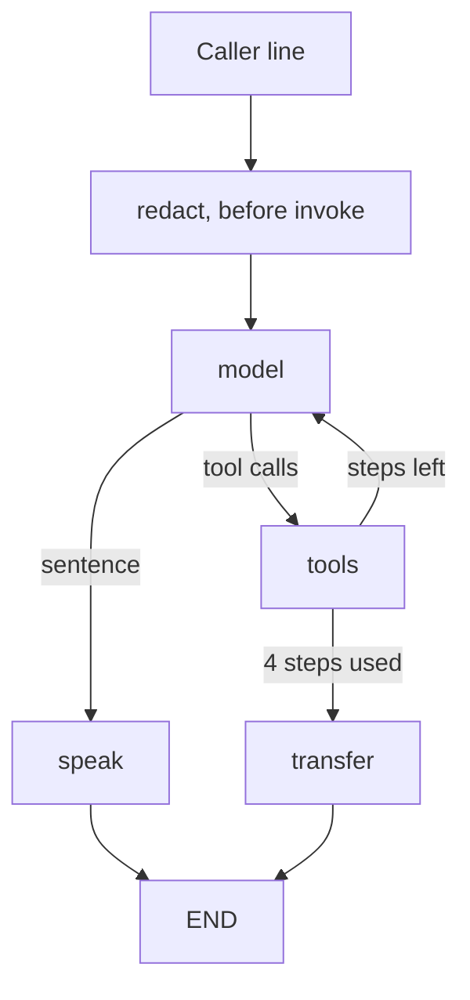

# LangGraph single agent

Same caller, same sandbox, same two-turn VPN call as [single_agent/](../single_agent/). The prompt, the tool schemas, `ServiceNowSandbox`, `redact`, and `normalize_speech` stay in that folder. This folder replaces the `for` loop in `handle_utterance`. What a node and an edge are is in [CONCEPTS.md](CONCEPTS.md). How the graph object is built, and how one caller line walks the nodes, is in [FLOW.md](FLOW.md).

`single_agent/` and `multi_agent/` use the standard library. This folder needs Python 3.12 and the packages pinned in [requirements.txt](../requirements.txt).

## Setup

`.python-version` selects 3.12. `.venv/` is gitignored.

```bash
uv venv --python 3.12 .venv
uv pip install -r requirements.txt
.venv/bin/python single_agent_langgraph/run.py --self-check
```

## The graph

`handle_utterance` calls the model, runs a tool when the name is in the handler map, and stops at a sentence or at 4 steps. Those branches are edges.



| Node | What it does | In the plain loop |
| --- | --- | --- |
| redact | `redact` on the caller line. The cleaned text is what `invoke` receives | First lines of `handle_utterance` |
| model | `model.invoke(messages)`. One step counted | `model.complete` |
| tools | Allow-list, then the sandbox method. Unknown names return `unknown_tool` | `_run_tool` |
| speak | `normalize_speech` on the model's sentence, written back onto that message | The return inside the loop |
| transfer | The same handoff sentence the plain loop uses after 4 steps | The return after the loop |

`InMemorySaver` stores the graph state after each node. The config key is `thread_id`, set to `"call"` for this process. The next caller line on that thread loads the message list. That is the job `self.messages` does on `VoiceConversationAgent`.

## Why redact sits outside the graph

The checkpointer writes the input before the first node runs. A social security number passed into `invoke` would be in that snapshot, even if a later node deleted it. `LangGraphDesk.handle_utterance` redacts first, then passes the cleaned line. `--self-check` reads every snapshot and asserts the raw number is absent.

The audit event for that redaction is still stored. The snapshot holds the label `[REDACTED_SSN]`, which is what the plain agent stores too.

## State

| Field | Holds | Lifetime |
| --- | --- | --- |
| `messages` | System prompt, caller lines, tool turns, spoken replies | The thread. The system prompt is written on the first line only |
| `steps` | Model calls for this caller line | Reset to 0 on each `invoke` |
| `tools_used` | Tool names for this caller line | Reset on each `invoke` |
| `escalated` | A transfer happened on this line | Reset on each `invoke` |
| `audit` | Redaction, model request, tool call, tool result, speech | Appended for the whole call |

`steps`, `tools_used`, and `escalated` are replaced when the next line arrives. `messages` and `audit` use a reducer, so a new line is added to what the checkpoint already has.

## Two models, one graph

| Flag | Model | What `invoke` hits |
| --- | --- | --- |
| `--demo`, `--self-check` | `ScriptedChatModel` | `ScriptedModel.complete`, the offline stand-in |
| `--live` | `ChatOpenAI.bind_tools` | `POST /chat/completions` on `OPENAI_BASE_URL` or OpenAI |
| `--voice` | `ChatOpenAI.bind_tools`, behind GPT-Live | The graph runs when GPT-Live delegates. The microphone and speakers stay in [chatgpt_live/](../chatgpt_live/). The callback is [live_voice.py](live_voice.py). |

`ScriptedChatModel` is the adapter. LangGraph wants an `AIMessage`. The rest of the repo wants a `ModelTurn`. The demo speech matches `python3 single_agent/voice_agent.py --demo`.

## The one-call version

`create_agent` builds this loop for you: a model node, a tools node, and an edge back until the model stops calling tools.

```python
from langchain.agents import create_agent
from langgraph.checkpoint.memory import InMemorySaver

agent = create_agent(
    model,
    TOOLS,
    system_prompt=SYSTEM_PROMPT,
    checkpointer=InMemorySaver(),
)
```

That call hides the allow-list, the step cap, and `normalize_speech`. This folder writes the nodes so those stay in view, next to the plain loop in [single_agent/agent.py](../single_agent/agent.py). The multi-agent note on length is in [multi_agent/README.md](../multi_agent/README.md). Checkpointing beyond this process is in [PATTERNS.md](../PATTERNS.md).

## Run

From the repo root, with the virtualenv:

```bash
.venv/bin/python single_agent_langgraph/run.py --demo
.venv/bin/python single_agent_langgraph/run.py --calls
.venv/bin/python single_agent_langgraph/run.py --self-check
.venv/bin/python single_agent_langgraph/run.py --show-contract
.venv/bin/python single_agent_langgraph/run.py --demo --audit
OPENAI_API_KEY=... .venv/bin/python single_agent_langgraph/run.py --live
OPENAI_API_KEY=... .venv/bin/python single_agent_langgraph/run.py --voice
```

`--voice` uses GPT-Live for speech. [live_voice.py](live_voice.py) passes each delegation transcript to `handle_utterance` and returns the sentence for GPT-Live to say. `--live` stays the typed chat-completions loop.

A self-hosted model uses the same `ChatOpenAI` client. [local_llm/](../local_llm/) runs that server.

```bash
OPENAI_BASE_URL=http://localhost:11434/v1 OPENAI_API_KEY=ollama \
  OPENAI_MODEL=llama3.2:3b .venv/bin/python single_agent_langgraph/run.py --live
```

`--self-check` covers the same cases as the plain desk: redaction, a ticket blocked until the caller agrees, the two demo lines, an unknown tool that never runs, and a stop after 4 steps.

`--calls` prints only the function list for the two demo lines. Each function prints `start` and `end`. The last line of a caller turn is the walk, for example `user → START → model → after_model→tools → tools(search_knowledge) → after_tools→model → model → after_model→speak → speak → END → user`.
